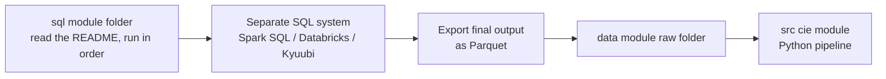

# SQL

All version-controlled SQL for the CIE pipeline lives here, grouped by module. **This repo never executes
SQL.** The queries are run on a separate system by a person, and the resulting tables are exported as
Parquet and dropped into `data/` where the Python pipeline picks them up.

## How the SQL fits into the pipeline

1. Open the module folder (for example `themes/`) and read its `README.md` to see which sub-modules exist and in what order they run.
2. Open the sub-module folder (for example `themes/seasonality/`) and follow its `README.md`: run order, what each script does, which table to export.
3. Run the scripts on the SQL system, in order.
4. Export **only the final output** named in the README (not the intermediate tables) as Parquet into `data/<module>/raw/`.

## Modules

| Folder | Purpose | SQL status |
|---|---|---|
| [`themes/`](themes/README.md) | Product themes (seasonality today, more theme types to come) | `seasonality/` documented |
| `need_states/` | Customer need states | empty |
| `nba/` | Next Best Action | empty |
| `journeys/` | Customer journeys (how it fits is still undecided) | empty |
| `affinity/` | Affinity (how it fits is still undecided) | empty |
| `opportunities/` | Consumes the final outputs of themes, need states and NBA | empty |
| `source/` | Shared source/base tables, not yet used | empty |

Intended module order: **themes -> need_states -> nba -> opportunities**.

## Conventions

- **Engine:** Spark SQL (Databricks / Kyuubi compatible). No `QUALIFY`, no `SELECT * EXCEPT`.
- **Schema:** every table is created in `lab_customer_value_analytics`.
- **Restartable:** each script does `DROP TABLE IF EXISTS` then `CREATE TABLE ... USING PARQUET AS`, so any
  script can be re-run safely. Re-running a script means re-running everything after it, because later
  tables read the earlier ones.
- **Numbered files:** `01_`, `02_`, ... is the run order inside a folder.
- **Parameters are in-table:** thresholds live in small `*_params` tables at the top of each script. Tune
  them there rather than editing logic.
- **Every folder has a README.** When you add or change SQL, update the README in the same folder.

## Adding a new SQL folder

Create `README.md` first with: purpose, prerequisites, run order, tables created, the final output to
export, and where in `data/` it goes.
