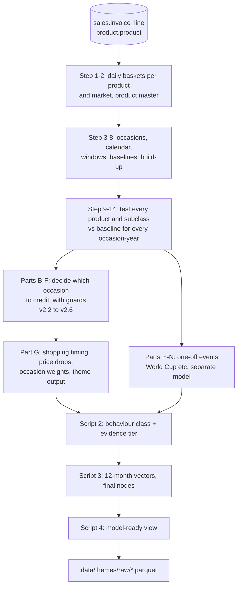

# Seasonality themes

## In 30 seconds

**What it answers.** For every product (TPNB): is it seasonal, for which occasion (Christmas, Easter, Halloween...), when do customers actually shop for it, how much of its sales depend on the occasion, and what is its monthly sales shape? One row per product comes out, with flags, labels, dates, weights and 12-month vectors, ready to build **themes** (`<subclass>|<behaviour class>`).

**How to run it.** Four SQL scripts, in order, on the SQL system. Export one view to Parquet and put it in `data/themes/raw/`.

**What to read first if you are new.** [docs/00_concepts_and_glossary.md](docs/00_concepts_and_glossary.md), then the script you care about.

> **Heads-up before running:** script 04 currently references two columns that no earlier script creates. See [docs/known_issues.md](docs/known_issues.md), issue 1.

---

## 1. Run order

Run each script completely, in this order. Every table is dropped and recreated, so any script can be re-run, but **everything after it must then be re-run too**.

| # | Script | Role in plain words | Reads | Builds (final) | Reference |
|---|---|---|---|---|---|
| 1 | [`01_seasonality_themes_final_production_v2_10.sql`](01_seasonality_themes_final_production_v2_10.sql) | The statistics. Compares each product with normal days around each occasion, decides which occasion to credit, measures shopping timing and importance. A second, separate model handles one-off events (World Cup...). | `sales.invoice_line`, `product.product` | `seasonality_v2_6_theme_output` + 3 more | [01 part A](docs/01_seasonality_themes.md#script-01-part-a-the-base-engine-v21-statements-0-15), [01 parts B-F](docs/01_seasonality_themes.md#script-01-parts-b-to-f-annual-policy-layers-v22-to-v26), [01 part G](docs/01_seasonality_themes.md#script-01-part-g-shopping-timing-weights-and-the-annual-theme-output-statements-17-24), [01 parts H-N](docs/01_seasonality_themes.md#script-01-parts-h-to-n-periodic-and-one-off-events-v24-to-v210) |
| 2 | [`02_seasonality_graph_features_v2_1_period_vectors_full_build.sql`](02_seasonality_graph_features_v2_1_period_vectors_full_build.sql) | Interprets script 1 as node features: behaviour class, evidence tier, repeated time-of-year evidence, identity evidence, data state. | script 1 tables | `seasonality_graph_v2_tpnb_features` | [02](docs/02_graph_features.md) |
| 3 | [`03_seasonality_graph_final_node_build.sql`](03_seasonality_graph_final_node_build.sql) | Maps time to 12 periods, builds monthly vectors, repairs missing subclass and out-of-range shares, builds theme nodes. | scripts 1 and 2 | `seasonality_graph_tpnb_nodes_final` | [03](docs/03_final_node_build.md) |
| 4 | [`04_seasonality_output.sql`](04_seasonality_output.sql) | Selects the columns Python consumes. | script 3 | **`seasonality_graph_tpnb_nodes_model_ready`** (view) | [04](docs/04_model_ready_output.md) |

Counts: script 1 builds 72 tables, script 2 builds 14, script 3 builds 16 (13 distinct, three built twice), script 4 builds 1 view. 103 statements in all. Full list with dependencies: [docs/table_catalog.md](docs/table_catalog.md).

**Needs access to:** `sales.invoice_line` (till lines) and `product.product` (product master). Engine: Spark SQL (Databricks / Kyuubi).

### What to export for Python

```
lab_customer_value_analytics.seasonality_graph_tpnb_nodes_model_ready
  -> data/themes/raw/seasonality_graph_tpnb_nodes_model_ready.parquet   (proposed name)
```

Everything else stays on the SQL system. If the theme tables or periodic events are needed later, export them the same way and add them to this section: `seasonality_graph_theme_nodes_final`, `seasonality_graph_theme_node_period_vectors`, `seasonality_v2_10_periodic_confidence`.

### Quick checks after each script (run on the SQL system)

These are suggested; they are not part of the scripts.

```sql
-- after script 1
SELECT COUNT(*) FROM lab_customer_value_analytics.seasonality_v2_6_theme_output;          -- = number of sold TPNBs
SELECT product_seasonality, COUNT(*) FROM lab_customer_value_analytics.seasonality_v2_6_theme_output GROUP BY 1;
-- after script 2
SELECT graph_behavior_class, graph_evidence_tier, COUNT(*)
FROM lab_customer_value_analytics.seasonality_graph_v2_tpnb_features GROUP BY 1, 2;
-- after script 3 (counts should match the theme output)
SELECT COUNT(*), COUNT(DISTINCT tpnb) FROM lab_customer_value_analytics.seasonality_graph_tpnb_nodes_final;
-- after script 4
SELECT COUNT(*), COUNT(DISTINCT tpnb) FROM lab_customer_value_analytics.seasonality_graph_tpnb_nodes_model_ready;
```

Expected: the row count is the same in all four, and `COUNT(*) = COUNT(DISTINCT tpnb)`.

---

## 2. How it works (one page)



1. **Daily facts.** Raw lines become "baskets containing product X" per day, plus market totals.
2. **Occasions.** About 70 occasions have dated occurrences, windows (pre, event, post) and a baseline of comparable days; for some, a longer data-driven **build-up** window is learned.
3. **Testing.** For each product and occasion-year, the product's **share of basket items** in the window is compared with its share on baseline days, matched by weekday. Uplift needs index >= 1.5 and z >= 3, repeated in at least two thirds of at least two years.
4. **Verdicts.** `Specifically seasonal` (sells almost only around the occasion), `Uplift seasonal`, `Occasion-suppressed`, `Regular`, `Insufficient evidence`.
5. **Policy layers (v2.2-v2.6).** Add guards: ignore false uplift on abnormal quiet days, require the subclass to agree for single-year evidence, check the product's wording does not point to a different occasion, require approved keywords for minor occasions, and credit each product to one clear occasion.
6. **Timing and weights.** When customers start, peak and finish buying; when price drops and ranges arrive; how important each occasion is.
7. **One-off events** are measured separately against the same dates in other years, adjusted for the pre-event trend and rated HIGH/MEDIUM/REVIEW. They never change annual flags.
8. **Graph layer.** Each product gets a behaviour class (seasonal-led, seasonal plus general, general only, candidates, low information), an evidence tier, 12 monthly vectors and a theme key.

### The headline fields

| Field | Values | Meaning |
|---|---|---|
| `graph_behavior_class` | `SEASONAL_LED`, `SEASONALITY_PLUS_GENERAL`, `GENERAL_ONLY`, `SEASONAL_PATTERN_CANDIDATE`, `GENERAL_PATTERN_CANDIDATE`, `LOW_INFORMATION_NODE` | What kind of product it is |
| `graph_evidence_tier` | `CONFIRMED`, `SUPPORTED`, `PROVISIONAL`, `LOW_INFORMATION` | How much to trust the class |
| `theme_node_key` | `<subclass>\|<class>` | The theme |
| `primary_occasion` | e.g. Christmas Day | The accepted occasion with the most extra sales |
| `final_seasonal_basket_share_pct` / `final_general_basket_share_pct` | 0-100 | Share of the product's baskets that is seasonal vs everyday |
| `period_*_array_12` | arrays of 12 | Monthly shape, P01 = January |
| `periodic_high_*` | flags, lists | Strong response to a one-off event (not seasonality) |

---

## 3. Where to find things

| I want to... | Go to |
|---|---|
| Learn the vocabulary | [docs/00_concepts_and_glossary.md](docs/00_concepts_and_glossary.md) |
| Understand how a product is called seasonal | [docs/01_seasonality_themes.md, parts A](docs/01_seasonality_themes.md#script-01-part-a-the-base-engine-v21-statements-0-15) (step 11) |
| Understand why a product was accepted or held for an occasion | [docs/01_seasonality_themes.md, parts B-F](docs/01_seasonality_themes.md#script-01-parts-b-to-f-annual-policy-layers-v22-to-v26) |
| Understand shopping timing, price drops, occasion weights | [docs/01_seasonality_themes.md, part G](docs/01_seasonality_themes.md#script-01-part-g-shopping-timing-weights-and-the-annual-theme-output-statements-17-24) |
| Understand World Cup / Olympics style events | [docs/01_seasonality_themes.md, parts H-N](docs/01_seasonality_themes.md#script-01-parts-h-to-n-periodic-and-one-off-events-v24-to-v210) |
| Understand classes, tiers, themes | [docs/02_graph_features.md](docs/02_graph_features.md) |
| Understand the 12-period vectors and final nodes | [docs/03_final_node_build.md](docs/03_final_node_build.md) |
| Look up a column of the exported file | [docs/04_model_ready_output.md](docs/04_model_ready_output.md) |
| Find which table feeds which | [docs/table_catalog.md](docs/table_catalog.md) |
| Change a threshold, occasion or keyword | [docs/parameters.md](docs/parameters.md) |
| See problems and open questions | [docs/known_issues.md](docs/known_issues.md) |

## 4. Things you must know

1. **Script 04 problem:** two columns it selects are not created anywhere in scripts 01-03 ([known_issues](docs/known_issues.md), #1).
2. **Hard-coded dates:** the data window and event calendar cover 2023-2026; several outputs have year-specific columns. Moving the window needs manual edits ([parameters](docs/parameters.md)).
3. **P01-P12 are calendar months** until the official commercial calendar arrives.
4. **Promotions and range landing are inferred** from price and sales, not taken from Tesco campaign or ranging data.
5. **Periodic events are not seasonality.** They live in separate `periodic_*` columns and describe observed responses only, with no causal claim.
6. **Event dates marked `SUPPLEMENT_V2_VERIFY`** (religious and some sports events) need confirming with the team.
7. **Three script-03 tables are built twice;** the second build is the real one.

## 5. FAQ

**Why compare a share of items rather than sales counts?** Traffic and basket size rise at peak times. A product only counts as seasonal if it takes a larger *share*, so general busyness does not create false seasonality.

**Why are there so many versioned tables (`v2_2` ... `v2_10`)?** Each layer fixed a specific false positive found in review and was added on top of the previous one without deleting it, so results can be compared across versions. Only the final tables of each chain matter downstream; the catalog marks them.

**Can a product be both seasonal and everyday?** Yes. `SEASONALITY_PLUS_GENERAL` means accepted seasonal peaks plus material sales the rest of the year.

**What happens to products with too little data?** They stay in the output as nodes with class `LOW_INFORMATION_NODE` (or a candidate class) and a `graph_data_state` that explains why. Only the first three classes are commercial themes.

**What is the difference between `Specifically seasonal` and `Uplift seasonal`?** Specifically: sells almost only around the occasion (core share at least 5x the rest of the year). Uplift: significantly higher around the occasion but also sells at other times.

**Why can a seasonal product have no primary occasion?** It may be seasonal by a repeated time-of-year pattern or by held/reviewed evidence, without an accepted named occasion. Check `occasion_attribution_status`.

**Can I re-run just part of the build?** Yes, from any script/part onward, because later tables read earlier ones. Re-running script 01 means re-running 02, 03 and 04.

**How do I tell which tables are important?** [docs/table_catalog.md](docs/table_catalog.md) marks each as EXPORT, FINAL, intermediate or terminal.

## 6. Keeping this documentation current

Update the matching file under `docs/` in the same change as any SQL edit. The table catalog's *Reads* and *Read by* columns were generated from the SQL; regenerate them when tables are added or renamed.
