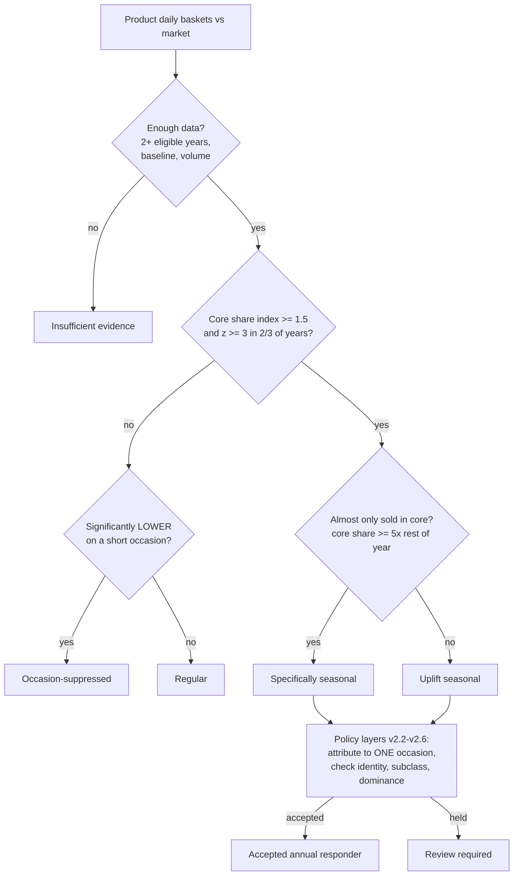

# Concepts and glossary

Read this first. Everything else in this folder assumes you know these terms. Each entry says where in the SQL the idea lives.

## 1. The question the pipeline answers

> For every product Tesco sells (a **TPNB**): is it a *seasonal* product, for *which* occasion, *when* do customers actually shop for it, *how much* of its sales depend on that occasion, and how does it behave the rest of the year?

The answer becomes one row per product with flags, labels, dates, weights and 12-month vectors. Products are then grouped into **themes** (`<subclass>|<behaviour class>`).

## 2. A worked example (numbers are illustrative)

Take "Tesco Mince Pies 6 pack".

1. **Raw sales** (script 01, step 1) are reduced to "how many baskets contained this product each day" and "how many baskets existed in total each day".
2. **Occasions** (step 3-4): Christmas Day is 25 Dec each year. Its config says: pre-event window = 7 days before, baseline = 4 weeks ending late November, and a *build-up* may be searched for up to 70 days earlier.
3. **Build-up calibration** (step 5b): looking at all Christmas-responding subclasses together, shopping really starts about 40 days before Christmas, so a "Christmas build-up" window is added.
4. **Comparison** (step 11): on each Christmas, mince pies took e.g. 3% of all basket item slots in the window versus 0.1% on comparable ordinary days. That is a share index of about 30 and a very large z-score, in each of 2023, 2024, 2025.
5. **Verdict**: the product sells almost only around Christmas, in 2 of 2+ eligible years, so the verdict is **Specifically seasonal** for Christmas.
6. **Policy layers** (v2.2 to v2.6): Christmas is a *major* occasion and the product name contains "MINCE PIE", so the attribution is accepted with no conflict.
7. **Timing** (step 18-19): the median year shows customers start buying 35 days before, peak about 6 days before, and finish 2 days before. A price drop begins 20 days before, so customers started ahead of the price drop.
8. **Graph layer** (script 02-03): accepted named seasonality with almost no off-season sales gives `SEASONAL_LED`, tier `CONFIRMED`, theme `<its subclass>|SEASONAL_LED`. Its monthly vector has most of the weight in P11 and P12.
9. **Output** (script 04): one row in `seasonality_graph_tpnb_nodes_model_ready`.

A banana would instead show no uplift near any occasion, sell in all 12 months, and become `GENERAL_ONLY` / `CONFIRMED`.

## 3. Glossary

### Entities and units

| Term | Meaning | Where |
|---|---|---|
| **TPNB** | Product identifier; the unit of analysis. | everywhere |
| **Subclass** | The lowest level of the commercial hierarchy (division > department > section > class > subclass). Written `SC:<code>` as an entity id. | step 2 |
| **Entity** | Either a TPNB or a subclass. Many steps run on both. `entity_level` is `TPNB` or `SUBCLASS`. | steps 9-14 |
| **Basket** | One shopping transaction, identified by country + channel + outlet + checkout + start time + transaction number. | step 1 |
| **Item slot** | One distinct TPNB in one basket. A basket with 20 different products has 20 item slots. A TPNB's "baskets" equals its item slots. | step 1, 9 |
| **Market** | All baskets, i.e. the `ALL` entity. Used as the denominator so a product is compared with overall traffic. | step 1 |
| **Share of items** | A product's item slots divided by the market's item slots on the same day. The core comparison metric. | step 11 |

### Time structure

| Term | Meaning |
|---|---|
| **Occasion** | A named dated event (Christmas Day, Easter Sunday, Mother's Day, World Cup). About 70 configured. |
| **Occasion family** | Group of occasions (CHRISTMAS_NEW_YEAR, EASTER, GIFTING_CELEBRATIONS, HALLOWEEN_BONFIRE, BANK_HOLIDAYS, FOOD_MOMENTS, RETAIL_EVENTS, NATIONAL_DAYS, WORLD_RELIGIOUS_CULTURAL, SPORT, ENTERTAINMENT_FESTIVALS, AWARENESS_DAYS). |
| **Major occasion** | `is_major = Y`. Its windows are removed from other occasions' baselines so Christmas does not distort Halloween. |
| **Occurrence** | One occasion in one year (for example "Easter 2024"). |
| **Parent occasion** | The occasion itself, as opposed to its build-up. `HALLOWEEN_BUILDUP` has parent `HALLOWEEN`. |
| **Windows** | PRE (days before), EVENT (the day(s) itself), POST (days after). **CORE = PRE + EVENT**; the verdict is based on CORE. |
| **Build-up** | A longer lead-in window whose start is *learned from data* (step 5b) rather than fixed. Treated as an occasion in its own right (`window_type = BUILDUP`). |
| **Baseline** | The comparison days: by default the nearest 28 usable days either side of the windows (after a 7-day gap). |
| **Usable day** | Not a low-traffic day, not inside a major occasion's windows, and not inside the same occasion's own windows. |
| **Low-traffic day** | A day whose baskets are under 50% of the median for that weekday in that year. |
| **Completed occurrence** | The occurrence has finished within the data and starts after the data starts. |
| **Complete year** | A calendar year with data from 1 Jan to 31 Dec. 2026 (year-to-date) is **not** complete, so it cannot count for annual-concentration tests. |
| **Annual vs periodic** | Annual occasions recur every year and drive seasonality. Periodic/one-off events (World Cup, Olympics, The Ashes...) have `recurrence_per_year < 1` and are modelled separately. They never change annual flags. |
| **Spell** | A run of days when a product was on sale. A gap of over 28 days with no sale ends a spell. |

### Statistics

| Term | Meaning |
|---|---|
| **Expected baskets** | What the product would have sold in the window if it behaved as in the baseline: market items per weekday in the window x the product's baseline share of items on that weekday. |
| **Share index** | actual / expected. 1.0 = normal, 1.5 = uplift threshold. Adjusts for traffic, weekday and basket size. |
| **Penetration index** | actual / (market baskets x baseline penetration). Adjusts for traffic only. |
| **z-score** | (actual - expected) / max(model sd, sqrt(expected)). 3.0 is the significance threshold (5.0 for periodic events). |
| **Absolute index** | actual / the product's normal same-weekday count, without scaling down for low market traffic (v2.2). Guards against false uplift on quiet days. |
| **Excess** | actual - expected on a day. Cumulating excess gives the shopping curve. |
| **Shopping start / mid / end** | The day after which cumulative excess stays above 10% / 50% / 90% of the year's total excess. |
| **Positive incremental baskets** | max(actual - expected, 0) summed over accepted positive windows. Used to rank which occasion matters most for a product. |
| **Parent signal share / rank** | Share of a product's (or subclass's) positive incremental baskets explained by one parent occasion, and its rank among them. Used to check that an occasion is a dominant driver. |

### Verdicts and labels

| Label | Where | Meaning |
|---|---|---|
| `Specifically seasonal` | step 11 | Sells almost only around the occasion (core share >= 5x the rest of the year) in at least two thirds of eligible years. |
| `Uplift seasonal` | step 11 | Significant uplift around the occasion in at least two thirds of valid years, but also sells outside it. |
| `Occasion-suppressed` | step 11 | Significantly *lower* around a short (14 days or less) occasion (for example a Christmas Day dip). |
| `Regular` | step 11 | Enough data and no seasonal effect. |
| `Insufficient evidence` | step 11 | Not enough eligible years or volume. |
| `Occasion mission shift` | v2.2 | Share gain on an abnormal low-traffic day with no absolute growth. Diagnostic only. |
| `Supported specifically/uplift seasonal` | v2.2-v2.4 | Only one positive occurrence, but backed by the subclass behaving the same way. Accepted only under strict conditions. |
| `Review required` | v2.4-v2.6 | A seasonal signal was found but attribution to an occasion was held. |
| `SEASONAL_LED`, `SEASONALITY_PLUS_GENERAL`, `GENERAL_ONLY`, `SEASONAL_PATTERN_CANDIDATE`, `GENERAL_PATTERN_CANDIDATE`, `LOW_INFORMATION_NODE` | script 02 | Graph behaviour classes. See [02](02_graph_features.md). |
| `CONFIRMED`, `SUPPORTED`, `PROVISIONAL`, `LOW_INFORMATION` | script 02 | Graph evidence tiers. |
| `HIGH`, `MEDIUM`, `REVIEW` | periodic | Confidence in a periodic-event response. |

### Version names

The SQL carries its history. `v2.1` is the base engine; `v2.2` to `v2.6` each add a policy layer on top without changing the earlier tables; `v2.4` to `v2.10` periodic are a separate chain. Only the **final** tables of each chain are used downstream. See [table_catalog.md](table_catalog.md) for which tables matter.

## 4. How "seasonal" gets decided, in one picture

