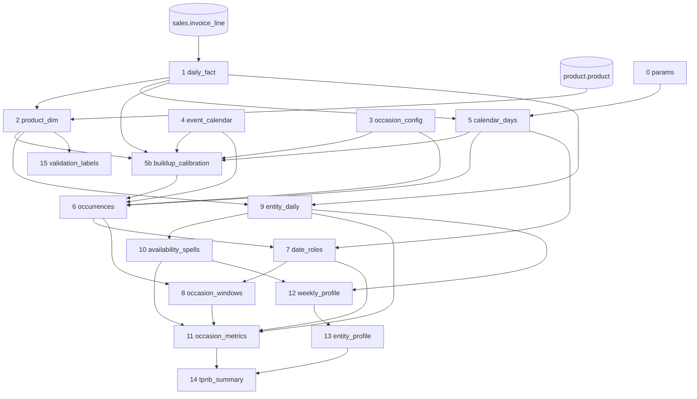
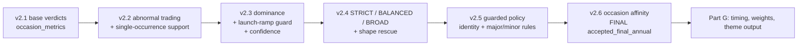
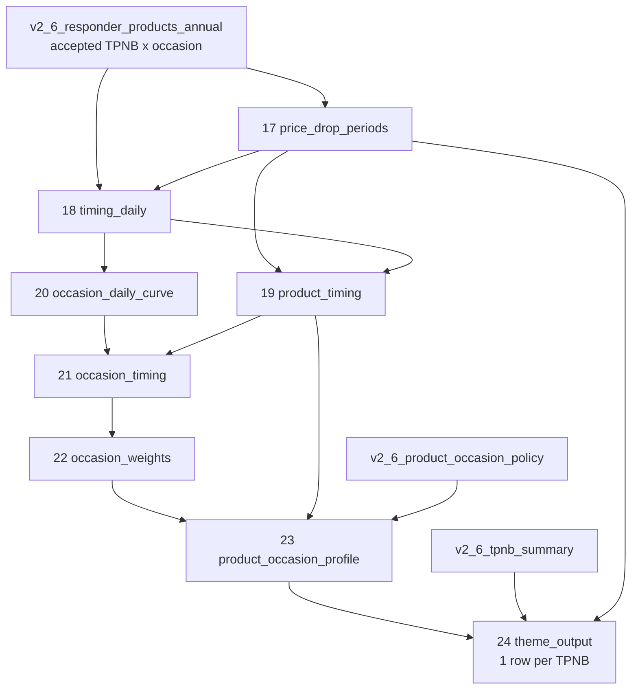
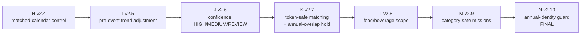

# Script 01: the statistical engine

File: [`01_seasonality_themes_final_production_v2_10.sql`](../01_seasonality_themes_final_production_v2_10.sql) (about 9,400 lines, 72 tables). This is the only script that reads raw sales.

This document has four parts, in the order the SQL runs:

| SQL parts | Covers | SQL version | Read it to understand |
|---|---|---|---|
| [A](#script-01-part-a-the-base-engine-v21-statements-0-15) | Base engine, statements 0-15 | v2.1 | how seasonality is measured |
| [B-F](#script-01-parts-b-to-f-annual-policy-layers-v22-to-v26) | Annual policy layers | v2.2 to v2.6 | why an occasion was accepted or held |
| [G](#script-01-part-g-shopping-timing-weights-and-the-annual-theme-output-statements-17-24) | Timing, weights and the annual theme output | v2.6, statements 17-24 | when customers shop, price drops, occasion importance |
| [H-N](#script-01-parts-h-to-n-periodic-and-one-off-events-v24-to-v210) | Periodic and one-off events | v2.4 to v2.10 | World Cup / Olympics style events |

Read [00_concepts_and_glossary.md](00_concepts_and_glossary.md) first.

---

## Script 01, part A: the base engine (v2.1, statements 0-15)

File: [`01_seasonality_themes_final_production_v2_10.sql`](../01_seasonality_themes_final_production_v2_10.sql), lines 1 to about 3435.

**What this part does in one sentence:** it turns raw till lines into daily counts, builds a calendar of occasions with windows and baselines, and tests every product and subclass for uplift around every occasion in every year.

**Read first:** [00_concepts_and_glossary.md](00_concepts_and_glossary.md).

Contents: [data flow](#data-flow) | [0 params](#0-parameters) | [1 daily fact](#1-daily-fact) | [2 product dim](#2-product-dimension) | [3 occasion config](#3-occasion-config) | [4 event calendar](#4-event-calendar) | [5 calendar days](#5-calendar-days) | [5b build-up calibration](#5b-build-up-calibration) | [6 occurrences](#6-occurrences) | [7 date roles](#7-date-roles) | [8 occasion windows](#8-occasion-windows) | [9 entity daily](#9-entity-daily) | [10 spells](#10-availability-spells) | [11 occasion metrics](#11-occasion-metrics-the-core) | [12 weekly profile](#12-weekly-profile) | [13 entity profile](#13-entity-profile) | [14 tpnb summary](#14-tpnb-summary) | [15 validation labels](#15-validation-labels)

### Data flow



### Key design choices (why it looks the way it does)

- **Compare against share of items, not raw counts.** Christmas week has a lot more traffic. Dividing the product's baskets by the market's item slots removes that, so only a genuinely higher *share* counts.
- **Weekday-matched baselines.** Saturday is compared with baseline Saturdays. Expected baskets are summed weekday by weekday.
- **Clean baselines.** Baseline days exclude low-traffic days, major occasions' windows, the same occasion's own windows, and days the product was not on sale (outside its spells).
- **Two ways to be seasonal.** Either a significant share uplift (Uplift) or extreme concentration around the occasion versus the rest of the year (Specifically).
- **Only one occasion gets credit** when windows overlap (see [attribution](#how-overlapping-occasions-are-attributed)).
- **Only the first step reads raw sales.** Every other table is built from small aggregates.

### 0. Parameters

Table `seasonality_v2_params` (1 row). Edit here to tune the whole base engine.

| Parameter | Default | Used for |
|---|---|---|
| `low_traffic_ratio` | 0.5 | A day under 50% of its weekday median is low traffic |
| `spell_max_gap_days` | 28 | A gap longer than this ends an on-sale spell |
| `min_baseline_days` | 14 | Fewer usable baseline days gives `INSUFFICIENT_BASELINE` |
| `min_expected_baskets` | 20 | Volume gate for the core window |
| `min_expected_baskets_window` | 10 | Volume gate for a single PRE, EVENT or POST window |
| `uplift_index_min` | 1.5 | Share index for an uplift (and 1/1.5 for a decline) |
| `z_min` | 3.0 | Significance threshold |
| `specific_ratio_min` | 5.0 | Core item share vs rest-of-year share for "specific" |
| `min_specific_baskets` | 20 | Minimum core baskets for the specific test |
| `promo_price_change_max_pct` | -10 | Price change at or below this counts as a price drop |
| `min_years` | 2 | Years needed before any verdict |
| `min_year_share` | 2/3 | Share of years that must agree |
| `limited_edition_max_days` | 120 | Longest on-sale run for a limited edition |
| `dow_index_min` | 1.15 | Day-of-week skew threshold |
| `baseline_max_scan_days` | 84 | How far past the gap a baseline may reach to find usable days |
| `nested_occasion_min_ratio` | 2.0 | An occasion nested inside a build-up must reach this multiple of the build-up's share |
| `timing_start_pct` / `timing_mid_pct` / `timing_end_pct` | 0.10 / 0.50 / 0.90 | Cumulative extra demand points that define shopping start, midpoint, end |
| `min_buildup_days` | 7 | A build-up shorter than this does not become its own window |
| `default_search_days` | 14 | Days searched before the pre-event window when an occasion sets none |
| `min_calibration_excess` | 50 | Extra item slots needed to calibrate one occasion-year |
| `promo_min_days` | 3 | A promotion period needs at least this many promoted days |
| `promo_max_gap_days` | 3 | Promoted days within this gap belong to one period |
| `timing_align_days` | 7 | Starts within this many days count as aligned |
| `range_landing_max_days` | 182 | An on-sale run starting within this many days before the event counts as a seasonal range |
| `min_profile_baskets` | 104 | Baskets needed for weekly and day-of-week profiles |

### 1. Daily fact

Table `seasonality_v2_daily_fact`. **The only read of `sales.invoice_line`.**

- **Filter:** `transaction_date` from 2023-01-01 up to (not including) 2027-01-01 and not in the future.
- **Row grain:** one row per day x `entity_type` x `entity_id`.
- **Entity types**

  | `entity_type` | `entity_id` | `baskets` | `items` |
  |---|---|---|---|
  | `TPNB` | the TPNB (or `NULL_TPNB`) | baskets containing it | 1 per basket |
  | `ALL` | `ALL` | all baskets that day | item slots (distinct TPNBs per basket, summed) |
  | `OUTLET` | outlet number | baskets in that outlet | item slots |
  | `SOURCE` | transaction source (channel) | baskets in that channel | item slots |

  Also stored: `sales`, `units`, `invoice_product_description`, `sale_year`, `sale_day_of_week` (1 = Sunday).
- **How it is computed:** lines are grouped into basket x TPNB rows (repeat lines of a TPNB in a basket are summed). Each basket emits one TPNB row per item and, from its first item only, one `ALL`, one `OUTLET` and one `SOURCE` row, so each basket is counted exactly once in those. Lines are distributed by day and a hash of the basket into 32 buckets to keep the shuffle cheap.

### 2. Product dimension

Table `seasonality_v2_product_dim` (one row per sold TPNB).

- Reads `product.product` for the **UKROI** market, only TPNBs that appear in the daily fact.
- Picks one row per TPNB when the master has several: prefers rows with a GB country record, then newest load date/time, then deterministic tie-breakers (`product_master_dedup_applied_flag` says if this happened).
- Keeps hierarchy (division, department, section, class, subclass codes and names), the description (customer-friendly first), `gb_launch_date`, `gb_deactive_date`, and `subclass_entity_id = 'SC:' + subclass code`.
- GB launch/deactivation dates are kept **for diagnostics only**. They do not exclude event-years, because observed sales spells proved more reliable.

### 3. Occasion config

Table `seasonality_v2_occasion_config` (hand-edited list, about 70 rows). Occasions not listed fall back to: family OTHER, lead 2 days, lag 0, gap 7, 4 baseline weeks each side, not major.

| Column | Meaning |
|---|---|
| `occasion_key`, `occasion_family`, `is_major` | Identity; major occasions' windows are removed from other occasions' baselines |
| `lead_days` | Length of the PRE window before the event |
| `lag_days` | Length of the POST window after the event |
| `baseline_gap_days` | Days skipped between the windows and the baseline |
| `baseline_weeks` | Weeks of baseline per side (so up to `7 x weeks` usable days) |
| `baseline_side` | `BOTH`, `BEFORE` or `AFTER` |
| `buildup_search_days` | How far before the event step 5b looks for the start of shopping. `NULL` = no build-up window |
| `recurrence_per_year` | How often it happens: 1 = yearly, 0.5 = every 2 years (The Ashes), 0.25 = every 4 years (World Cup, Olympics, Euros). `< 1` marks a periodic event |
| `config_note` | Free text |

Notable settings

| Occasion | Lead / lag | Baseline | Build-up search |
|---|---|---|---|
| Christmas Day (major) | 7 / 0 | 4 weeks, BEFORE only, gap 21 (ends late Nov) | 70 days |
| Boxing Day (major) | 0 / 2 | BEFORE, gap 29 | none |
| New Year's Eve (major) | 1 / 0 | BEFORE, gap 33 | none |
| New Year's Day (major) | 0 / 7 | BEFORE, gap 35 | none |
| Easter Sunday (major) | 3 / 1 | BOTH, gap 7 | 49 days |
| Mother's / Father's Day, Valentine's (major) | 3 / 0 (Valentine's 2 / 0) | BOTH | 21 days |
| Halloween (major) | 5 / 0 | BOTH | 35 days |
| Bonfire Night, bank holidays (major) | 3 / 0 | BOTH | none |
| Pancake Day (major) | 3 / 0 | BOTH | 14 days |
| Black Friday (major) | 0 / 3 (to Cyber Monday) | BOTH | 21 days |
| Back to School | 7 / 0 | BOTH | 42 days |
| Ramadan, Passover | 3 / 0 | BOTH | 14 days |
| Burns Night, Lunar New Year, Diwali | 3 / 0 (Lunar 3 / 1) | BOTH | 21 days |
| Most sport, entertainment and awareness days | 0-3 / 0 | BOTH, 4 weeks | none |

### 4. Event calendar

Table `seasonality_v2_event_calendar`: one dated row per occasion x year (2023 to 2026).

Dates come from three sources. When the same occasion-year appears more than once, the highest-priority row wins:

| Priority | `date_origin` | What it is |
|---|---|---|
| 1 | `SOURCE_EXPLICIT` | Dates from the team's source calendar |
| 2 | `SAFE_RULE_EXPANSION` | Rule-based expansion of fixed annual dates in the source calendar |
| 3 | `RULE_COMPUTED_V2` | Computed here from rules: **Easter** (Gregorian algorithm), **Mother's Day** (Easter minus 21), **Pancake Day** (Easter minus 47), **Father's Day** (third Sunday of June), **Early May bank holiday** (first Monday of May), **Spring bank holiday** (last Monday of May), **Summer bank holiday** (last Monday of August), **Black Friday** (day after US Thanksgiving), **Remembrance Sunday** (second Sunday of November), **World Book Day** (first Thursday of March), **Back to School** (1-30 September, an approximate business window), **New Year's Eve** (31 Dec) |
| 4 | `SUPPLEMENT_V2_VERIFY` | Looked-up dates for moving religious and sporting events in years the source lacks: Lunar New Year, Diwali, Ramadan, Eid al-Fitr, Holi, Passover, Hanukkah, Wimbledon, Six Nations, Grand National, FA Cup Final. **These need confirming with the team.** |

Also carried: `recurrence_handling` (for example `FIXED_ANNUAL_DATE`, `RULE_BASED_ANNUAL_DATE`, `APPROXIMATE_BUSINESS_WINDOW`, `EXPLICIT_YEARLY_DATE_REQUIRED`, `PERIODIC_OR_ONE_OFF`). Rows with `FIXED_ANNUAL_MONTH` are dropped.

### 5. Calendar days

Table `seasonality_v2_calendar_days`: one row per day from the first to the last day with data (capped at today).

| Column | Meaning |
|---|---|
| `all_baskets`, `all_items`, `all_sales` | Market totals (zero if no trading) |
| `active_outlets` | Number of outlets that traded |
| `weekday` | 1 = Sunday ... 7 = Saturday |
| `median_weekday_baskets` | Median `all_baskets` for the same weekday in the same year |
| `is_low_traffic_day` | `Y` if `all_baskets` is under `low_traffic_ratio` x that median (catches Christmas Day closures, bank-holiday troughs, outages) |
| `data_start_date`, `data_through_date` | Coverage |

### 5b. Build-up calibration

Table `seasonality_v2_buildup_calibration`. Answers: *when does extra demand for this occasion really begin?*

Runs only for occasions with `buildup_search_days` set and a finished occurrence in the data. Done on **subclasses**, before any product is flagged, so it does not depend on the fixed windows it is adjusting. For each occasion-year:

1. **Responders.** Subclasses whose item share in the occasion's own window (PRE + EVENT) is >= 1.5 x baseline and significant (z >= 3), **or** concentrated there (>= 20 item slots and >= 5 x expected). A subclass responding to two occasions with overlapping search ranges counts only for the one where its window share is highest.
2. **Baseline.** Nearest 28 usable days before the search range (7-day gap); if fewer than 14, add the nearest 28 usable days after the event. Usable excludes low-traffic days and other major occasions' windows and search ranges.
3. **Daily extra demand.** Responders' item slots minus expected (weekday-matched), summed from the start of the search range to the end of the event; days inside another major occasion's window count as zero.
4. **Shopping start / mid / end.** The day after which the running total stays at or above 10% / 50% / 90% of the year's total. Brief early noise that touches 10% and falls back is ignored.

Result columns include `shopping_start_days_before`, `peak_days_before`, `responder_subclasses`, `total_excess_slots`, `is_valid_year` (baseline ok, at least one responder, extra demand >= 50), `top_responder_subclasses` (the five biggest, for human review), `years_calibrated`, `calibrated_lead_days` (median of start-days-before over valid years), `buildup_days = calibrated_lead_days - lead_days`, and `has_buildup = Y` when at least 2 years are valid and the build-up is at least 7 days longer than the PRE window.

**Review tip.** If `top_responder_subclasses` shows another occasion's season (for example Diwali products inside the Christmas build-up), set that occasion's `buildup_search_days` to `NULL` in step 3.

### 6. Occurrences

Table `seasonality_v2_occurrences`: one row per occasion x year **and** one extra `BUILDUP` row wherever calibration found a build-up.

- `window_type`: `EVENT` or `BUILDUP`. A build-up is an occasion in its own right (`<KEY>_BUILDUP`, name "<occasion> build-up"), same family and major flag, running from the calibrated start to the day before the PRE window. It has no lead or lag, a 7-day gap, 4 baseline weeks, BEFORE side only.
- `parent_occasion_key` links a build-up back to its event.
- Window dates: `pre_start_date`, `pre_end_date`, `post_start_date`, `post_end_date`, and the scan ranges for baseline days `base_before_start/end_date` and `base_after_start/end_date`.
- `is_completed = Y` when the whole occurrence (to the end of POST) is inside the data. `calendar_years_available` counts completed years per occasion.

### 7. Date roles

Table `seasonality_v2_date_roles`: for each completed occurrence, the role of each date.

| Role | Dates |
|---|---|
| `PRE`, `EVENT`, `POST` | The occasion's windows |
| `BASE` | The nearest `7 x baseline_weeks` usable days on each baseline side, scanning up to 84 days beyond the gap. Usable = not low traffic, not inside a **major** occasion's own windows, not inside the **same occasion's** build-up or event windows. Other occasions' build-ups deliberately **stay in** the baseline, because that is the season the occasion has to stand out from |
| `YEAR` | Every day of each calendar year, under a pseudo-occurrence `YEAR_<year>` (used for annual totals) |

Each row also carries that day's weekday, market baskets, items and low-traffic flag.

### 8. Occasion windows

Table `seasonality_v2_occasion_windows`: one row per completed occurrence with the **calendar-side** totals the tests need.

- `*_by_dow` arrays have 7 slots (1 = Sunday ... 7 = Saturday) for PRE, EVENT, POST, CORE and BASE: days, market items, market baskets. `*_items_sq` for variance.
- `base_days`: the list of usable baseline days (used for the on-sale check).
- `core_start_in_data`, `core_end_in_data`, `event_low_traffic_days`, `year_items`, `year_is_complete`.
- `overlapping_core`: other occasions whose CORE shares days with this one, with `inside_pct` (share of this core they cover), `other_inside_pct` (share of their core inside this one) and `other_is_buildup`.

### 9. Entity daily

Table `seasonality_v2_entity_daily`: day x entity for both TPNBs and subclasses.
A subclass's `baskets` is the sum of its TPNBs' baskets (its item slots), the same unit as market items, so shares are consistent. `NULL_TPNB` is excluded.

### 10. Availability spells

Table `seasonality_v2_availability_spells`: per entity, runs of sale days with no gap longer than 28 days. Days inside a spell count as "on sale" even when nothing sold. Days outside every spell (before launch, after delisting, long out-of-stock) are left out of baselines. Columns: `spell_no`, `spell_start`, `spell_end`, `sale_days`, `spell_days`.

### 11. Occasion metrics (the core)

Table `seasonality_v2_occasion_metrics`: **one row per entity x occurrence.** About a hundred columns; this is where "seasonal or not" is decided.

#### What is computed for each window W in {PRE, EVENT, POST, CORE}

```
expected_baskets_W = sum over weekdays k of
                     (market items in W on weekday k) x (entity's mean daily item share on weekday k in its baseline)
share_index_W      = actual_baskets_W / expected_baskets_W
z_W                = (actual - expected) / max(model_sd, sqrt(expected))
```

- The **model sd** uses the day-to-day spread of the entity's share in its baseline plus the uncertainty of the baseline mean itself.
- Baseline days count only when the entity was on sale (the availability check).
- `core_penetration_index` is the traffic-only alternative.
- Sales are valued at the entity's baseline sales per basket (`core_expected_sales`, `core_incremental_sales`, `core_sales_uplift_pct`) and price is compared (`core_price_change_pct`).

#### Status for the core window (`core_status`)

| Order | Condition | Status |
|---|---|---|
| 1 | Fewer than 14 usable baseline days | `INSUFFICIENT_BASELINE` |
| 2 | Expected baskets under 20 | `LOW_VOLUME` |
| 3 | share index >= 1.5 and z >= 3 | `SIGNIFICANT_UPLIFT` |
| 4 | share index <= 1/1.5 and z <= -3 | `SIGNIFICANT_DECLINE` |
| 5 | otherwise | `NOT_SIGNIFICANT` |

Window flags `pre_uplift`, `event_uplift`, `post_uplift` use the same thresholds with the smaller window volume gate (10).

#### The "specific" test

`specific_share_ratio = core item share / rest-of-year item share`. A year passes if it is eligible, in a **complete** year, has at least 20 core baskets, and either the product has no sales outside the core or the ratio is >= 5. An incomplete year (2026 YTD) can add local uplift evidence but never pass the annual specific test.

#### Eligibility

`eligibility_status = ELIGIBLE` when the entity was on sale in the core window (any spell overlaps), otherwise `NOT_ON_SALE_AROUND_EVENT`.

#### How overlapping occasions are attributed

When two occasions' CORE windows share days, a positive result should count only once. For each positive (specific or uplift) entity-year:

- It looks at the entity's other positive occurrences in the same year that overlap.
- A **build-up** can claim an occasion that sits at least half inside it, unless the occasion's item share is at least **2 x** the build-up's (`nested_occasion_min_ratio`). A build-up is never claimed by an occasion nested inside it.
- Otherwise the clearly higher share wins: another window wins if it covers at least half of this core and its share is at least 90% of this one's, or if its share is more than 110% of this one's.
- A year lost this way is `is_attributed_elsewhere` (with `attributed_to` naming the winner) and no longer counts as eligible for this occasion.

#### Year flags and across-year counts

Per year: `is_eligible_year`, `is_specific_year`, `is_valid_year` (eligible and uplift/decline/not-significant), `is_uplift_year`, `is_decline_year`, `is_price_drop_uplift_year` (uplift with core price change <= -10%), `is_post_valid_year`.
Across years (same on every year-row of the entity x occasion): `years_eligible`, `years_specific`, `years_valid`, `years_uplift`, `years_decline`, `years_low_volume`, `years_insufficient_baseline`, `years_attributed_elsewhere`, `years_pre/event/post_uplift`, `median_core_share_index`, `pooled_core_share_index`.

#### The verdict (`seasonality_flag`)

| Order | Condition | Verdict |
|---|---|---|
| 1 | `years_eligible` < 2 | Insufficient evidence |
| 2 | `years_specific` > 0 and >= 2/3 of eligible years | **Specifically seasonal** |
| 3 | `years_valid` < 2 | Insufficient evidence |
| 4 | `years_uplift` >= 2/3 of valid years and median share index >= 1.5 | **Uplift seasonal** |
| 5 | `years_decline` >= 2/3 of valid years, median index <= 1/1.5, event length <= 14 days | **Occasion-suppressed** |
| 6 | otherwise | Regular |

Extra labels: `evidence_status` (SUFFICIENT or LIMITED with reason), `promotion_flag` (`POSSIBLY_PROMOTION_DRIVEN` if Uplift and at least half of uplift years had a price drop), `post_event_flag` (`Post-event uplift`), `timing_profile` (for example `PRE+EVENT`), and a human-readable `classification_reason`.

### 12. Weekly profile

Table `seasonality_v2_weekly_profile`: entity x week of year, **complete calendar years only**.

- Week of year = `min(52, ceil(day-of-year / 7))` (week 52 absorbs days 358-366) so the same week number means the same dates every year.
- `week_index = (entity share of items that week) / (entity share over its whole profile)`. 1.0 is a normal week, 2.0 is twice its usual share.
- Only days between the entity's first and last on-sale date count, so weeks before a launch or after a delisting are not shown as zero demand; gaps inside the range (a seasonal product off the shelf) do count as zero.

### 13. Entity profile

Table `seasonality_v2_entity_profile`: one row per entity with whole-period descriptors.

| Group | Fields and rule |
|---|---|
| Volume | `total_baskets`, `total_sales`, `total_units`, `sales_2023`, `sales_2024`, `sales_2025`, `sales_2026_ytd` (these year columns are hard-coded), `avg_unit_price`, `avg_sales_per_basket`, `sale_days`, first/last sale date |
| Time of year | `best_8_week_share_pct`: share of the weekly index in the strongest 8 consecutive weeks (wrapping New Year); flat = 8/52 = 15.4%. `seasonal_concentration_index = best share / 15.4%`. `peak_week`, `peak_weeks`, `peak_season` (Winter Dec-Feb, Spring Mar-May, Summer Jun-Aug, Autumn otherwise, by the month of the peak week). `seasonality_strength_cv`. |
| `time_of_year_pattern` | `Low volume` (under 104 profile baskets); `Strong <season> peak` (concentration >= 2.0); `<Season> peak` (>= 1.4); else `Even through the year` |
| Day of week | `weekend_index` (Sun+Sat), `friday_index`, `midweek_index` (Mon-Thu) vs the entity's ordinary-day share, with z-scores. Ordinary days exclude low-traffic days, short occasions' core windows and major occasions' windows |
| `day_of_week_pattern` | `Weekend-heavy` (index >= 1.15, z >= 3, and at least Friday's), `Friday-heavy`, `Weekday-heavy` (weekend <= 1/1.15, z <= -3), `Even across the week`, `Low volume` |
| Availability | `on_sale_spells`, `longest_spell_days`, `on_sale_days`, first/last on-sale date |
| `availability_pattern` | `Year-round` (on sale >= 80% of days) / `Recurring seasonal` (2+ spells, longest <= 150 days, starting in 2+ years) / `One-off limited edition` (1 spell <= 120 days, not touching either end of the data) / `Launched during period` / `Delisted during period` / `Intermittent` |

### 14. TPNB summary

Table `seasonality_v2_tpnb_summary`: one row per TPNB rolling the per-occasion verdicts up.

- Flags: `specifically_seasonal_flag` (at least one occasion), `uplift_seasonal_flag`, `regular_flag` (Regular overall), `occasion_suppressed_flag`, `promotion_driven_flag`, `post_event_uplift_flag`, `limited_edition_flag`, and 12 `family_*` flags.
- `product_seasonality` priority: Specifically > Uplift > Occasion-suppressed > Regular > Insufficient evidence.
- **Subclass fallback:** a TPNB with Insufficient evidence inherits the subclass's Specifically/Uplift label if it sold in at least 2 years (`inherited_subclass_seasonality`, `seasonality_evidence_source = SUBCLASS (inherited)`).
- Occasion lists, `peak_occasion` (specific first, then highest median index), time-of-year, day-of-week, availability and volume columns.

### 15. Validation labels

Table `seasonality_v2_validation_labels`: a **seed list**, not ground truth. Products whose description matches known seasonal keywords (MINCE PIE, CHRISTMAS, XMAS, ADVENT CALENDAR, PANETTONE, STOLLEN, SELECTION BOX, PIGS IN BLANKETS, EASTER EGG, HOT CROSS BUN, SIMNEL, MINI EGGS, CREME EGG, HALLOWEEN, CARVING PUMPKIN, SPARKLER, VALENTINE, MOTHERS DAY, FATHERS DAY, PANCAKE, HAGGIS) are labelled `SEASONAL`; everyday staples (BANANAS, TOILET TISSUE/ROLL, TEA BAGS, BAKED BEANS, WASHING UP LIQUID, TOOTHPASTE, SEMI SKIMMED MILK, WHITE BREAD) are `EVERYDAY`. Used to build the v2.4 review sample and meant for before/after scoring when methods change. The "section 16 scoring queries" the header mentions are not in the file.

**Next:** [Script 01, parts B to F](01_seasonality_themes.md#script-01-parts-b-to-f-annual-policy-layers-v22-to-v26).


---

## Script 01, parts B to F: annual policy layers (v2.2 to v2.6)

File: [`01_seasonality_themes_final_production_v2_10.sql`](../01_seasonality_themes_final_production_v2_10.sql), roughly lines 3436 to 6080.

**What these parts do in one sentence:** the base engine ([01 part A](01_seasonality_themes.md#script-01-part-a-the-base-engine-v21-statements-0-15)) says a product *responds* to an occasion; these layers decide whether to **trust and accept** that, and credit it to the **right single occasion**, adding guards against known false positives.

Each layer reads the previous layer's tables and **adds new tables with a new version prefix**. It never overwrites the layer below, so any version can be inspected or compared. None of them re-reads `sales.invoice_line`.



The final accepted set is the column **`accepted_final_annual = TRUE`** in `seasonality_v2_6_product_occasion_policy`.

---

### Part B (v2.2): abnormal trading and single-occurrence support

Prefix `seasonality_v2_2_*`. Order: params, market_context, absolute_metrics, occasion_metrics, product_occasion_evidence, tpnb_summary, responder_products.

#### Problem it solves
On days when the whole market collapses (Boxing Day, New Year's Day), almost every product's *share* of items can rise just because fewer things are bought. That is a **mission shift**, not seasonality.

#### Parameters (`seasonality_v2_2_params`)

| Parameter | Value | Meaning |
|---|---|---|
| `abnormal_market_basket_ratio_max` | 0.65 | Core-window market baskets below 65% of the same-weekday baseline expectation |
| `abnormal_low_traffic_day_share_min` | 0.50 | and at least half of the core days are low traffic |
| `abnormal_absolute_index_min` | 1.00 | On an abnormal window, actual baskets must at least match the normal level |
| `abnormal_absolute_z_min` | 0.00 | and the absolute z-score must not be negative |
| `supported_single_min/max_positive_years` | 1 / 1 | Exactly one positive year allowed for "supported" evidence |

#### Tables

| Table | Grain | What it does |
|---|---|---|
| `_market_context` | occurrence | Compares the market's core baskets with what the baseline implies. `trading_regime_status` = `ABNORMAL_LOW_TRAFFIC` or `NORMAL_OR_UNDETERMINED`. Also outlet counts. |
| `_absolute_metrics` | entity x occurrence | **Only for candidates**: significant-uplift rows on abnormal windows. Compares actual baskets with the entity's normal same-weekday count, *not* scaled down for low traffic. Gives `core_absolute_basket_index` and `core_absolute_z`. |
| `_occasion_metrics` | entity x occurrence | All v2.1 columns plus the new diagnostics and `core_status_v2_2`, `seasonality_flag_v2_2`. Re-runs the attribution and across-year logic with the new status. |
| `_product_occasion_evidence` | TPNB x parent occasion | Combines the EVENT and BUILDUP verdicts, adds same-parent subclass support, separates periodic events. |
| `_tpnb_summary` | TPNB | v2.1 summary plus resolved evidence counts and lists. |
| `_responder_products` | TPNB x occasion | Candidate list for a future timing rebuild. Not used by the final chain. |

#### New verdict rules
- If a window is `ABNORMAL_LOW_TRAFFIC` and the share uplift is not matched by absolute demand (absolute index < 1 or z < 0), the year is **`MISSION_MIX_UPLIFT`** and the verdict becomes **`Occasion mission shift`** (needs the same 2/3 year rule). It is a diagnostic, not seasonal.
- A periodic or one-off occasion (`recurrence_handling = PERIODIC_OR_ONE_OFF`) gets verdict `Insufficient evidence` in the annual chain and is tagged `OBSERVED_OCCURRENCE_RESPONSE` instead.
- Other verdict rules are as v2.1.

#### Combining event and build-up (`_product_occasion_evidence`)
Each parent occasion has an EVENT verdict and maybe a BUILDUP verdict. They are ranked **Specifically seasonal (1) > Uplift seasonal (2) > Occasion-suppressed (3) > Mission shift (4) > Regular (5) > Insufficient evidence (6)** and the better one becomes `confirmed_parent_verdict`. `confirmed_timing_type`: `BUILDUP_AND_EVENT`, `BUILDUP_ONLY`, `EVENT_ONLY`, `EVENT`, `MISSION_SHIFT`.

#### "Supported" single-occurrence evidence
A product with only **one** good year can still be accepted if its subclass backs it:

| Resolved verdict | Conditions |
|---|---|
| `Supported specifically seasonal` | confirmed verdict is Insufficient evidence; no decline years; exactly 1 specific year; subclass is `Specifically seasonal` for the same parent; product is **not** `Year-round` |
| `Supported uplift seasonal` | as above but exactly 1 uplift year and subclass is Specifically **or** Uplift seasonal; product not Year-round; and not in division `HOME & CLOTHING` unless the subclass is Specifically seasonal |
| `Observed occurrence response` | a periodic event with at least one response year |

`occasion_confidence`: **HIGH** (confirmed, subclass also seasonal), **MEDIUM** (confirmed only), **SUPPORTED**, **OCCURRENCE_ONLY**, **DIAGNOSTIC** (mission shift), **NONE**. `evidence_source_v2_2` explains the basis (for example `TPNB_MULTI_OCCURRENCE`, `TPNB_SINGLE_OCCURRENCE_PLUS_SAME_PARENT_SUBCLASS`).

---

### Part C (v2.3): dominance, launch ramp, confidence

Prefix `seasonality_v2_3_*`.

#### Problem it solves
Single-occurrence "supported" evidence was too generous: a product could be supported for a minor parent occasion that is not what really drives it, or a newly launched product's ramp-up could look like uplift.

#### Parameters (`seasonality_v2_3_params`)

| Parameter | Value | Meaning |
|---|---|---|
| `support_product_parent_share_min` | 0.40 | The parent must explain at least 40% of the product's positive incremental baskets |
| `support_subclass_parent_share_min` | 0.40 | and 40% of the subclass's |
| `support_product_parent_rank_max` / `support_subclass_parent_rank_max` | 2 / 2 | and be among each entity's top 2 parents |
| `launch_ramp_guard_days` | 28 | Uplift in the first 28 days of a newly observed range is "launch ramp" |
| `confirmed_parent_share_high_min` | 0.25 | A confirmed parent explaining >= 25% of signal can be HIGH |
| `confirmed_review_family_count_min` | 3 | A year-round product responding across 3+ unrelated families is REVIEW |
| `periodic_z_min` | 5.0 | Stronger threshold for one-off events |
| `periodic_incremental_baskets_min` / `_sales_min` | 100 / 1000 | Materiality of a periodic response |

#### Tables
- `_parent_signal_features` (entity x parent occasion): positive incremental baskets and sales (only specific/uplift years count), positive years, max positive share index, **`parent_signal_share`** and **`parent_signal_rank`** (this parent's share of the entity's total positive signal and its rank), `positive_parent_count`, `positive_family_count`, and `min_days_from_first_sale_to_signal`.
- `_product_occasion_evidence` (TPNB x parent): re-evaluates "supported" under tighter rules.
  - `Supported specifically seasonal` stays only if subclass is Specifically seasonal, product share >= 40%, subclass share >= 40%, both ranks <= 2, no decline years.
  - `Supported uplift seasonal` stays only if subclass is Specifically or Uplift, shares >= 40%, both ranks **= 1**, no decline years, and either not a launch ramp or the subclass is Specifically seasonal.
  - Otherwise it drops to `Insufficient evidence`, with `support_rejection_reason_v2_3` explaining (`PRODUCT_PARENT_NOT_MATERIAL`, `SUBCLASS_PARENT_NOT_MATERIAL`, `PRODUCT_PARENT_NOT_DOMINANT`, `SUBCLASS_PARENT_NOT_DOMINANT`, `POSSIBLE_RANGE_LAUNCH_RAMP`).
  - `launch_ramp_flag = Y` when availability is `Launched during period` and the signal begins within 28 days of first sale.
  - Confirmed rows get `occasion_confidence_v2_3`: **HIGH** (subclass also seasonal and product share >= 25%), **REVIEW** (year-round product responding to 3+ families), else **MEDIUM**; supported rows are `SUPPORTED_STRICT`.
- `_tpnb_summary`: roll-up with `confirmed_review_required_flag_v2_3`.
- `_periodic_response`: TPNB x periodic event x year, status `MATERIAL_OBSERVED_RESPONSE` if z >= 5, incremental baskets >= 100 and sales >= 1000. **Superseded** by the periodic chain ([01 parts H-N](01_seasonality_themes.md#script-01-parts-h-to-n-periodic-and-one-off-events-v24-to-v210)); nothing reads it.

---

### Part D (v2.4): production policies

Prefix `seasonality_v2_4_*` (the annual ones; periodic params of the same version number are in parts H to N below).

#### What it adds
1. A **seasonal-shape rescue** for credible one-season products.
2. Three automation scenarios: **STRICT**, **BALANCED**, **BROAD**.
3. A deterministic review sample.

#### Parameters (`seasonality_v2_4_params`)
`shape_rescue_product_share_min` 0.25, `shape_rescue_subclass_share_min` 0.25, `shape_rescue_parent_rank_max` 2, `shape_rescue_concentration_min` 1.40, `year_round_override_parent_share_min` 0.50, `year_round_override_family_count_max` 2, `review_sample_rows_per_stratum` 5.

#### Tables
- `_subclass_parent_shape`: for each subclass x parent occasion, whether the subclass's own availability or 52-week profile is seasonal **in the same part of the year as the occasion** (`occasion_season` from the median event month). `subclass_has_matching_seasonal_shape = Y` if the subclass is `Recurring seasonal`, or its concentration index >= 1.4 and its peak season equals the occasion's season.
- `_product_occasion_policy` (TPNB x parent): applies the **rescue**: a "Supported" row that v2.3 rejected is brought back (`SUPPORTED_SHAPE`) when the subclass verdict is seasonal, product and subclass shares >= 25%, both ranks <= 2, no decline years, matching seasonal shape, and (not HOME & CLOTHING or subclass Specifically). Then assigns:

  | `production_status` | Meaning |
  |---|---|
  | `AUTO_ACCEPT_SUPPORTED` | supported or rescued |
  | `AUTO_ACCEPT_CONFIRMED_HIGH` | confirmed, HIGH confidence |
  | `AUTO_ACCEPT_CONFIRMED_MEDIUM_CANDIDATE` | confirmed, MEDIUM |
  | `MANUAL_REVIEW_CONFIRMED` | confirmed, REVIEW |
  | `DIAGNOSTIC_MISSION_SHIFT`, `OCCURRENCE_ONLY_PERIODIC`, `NO_ACCEPTED_SEASONAL_EVIDENCE` | not accepted |

  and three boolean scenario columns:

  | Column | Accepted when |
  |---|---|
  | `accepted_strict` | supported/rescued, or confirmed HIGH |
  | `accepted_balanced` | strict, **or** confirmed MEDIUM and not Year-round, **or** confirmed MEDIUM Year-round with subclass seasonal, product share >= 50% and at most 2 families |
  | `accepted_broad` | supported, or confirmed HIGH or MEDIUM |

  `production_review_reason` (for example `YEAR_ROUND_MULTI_FAMILY_OR_WEAK_PARENT_ATTRIBUTION`, `YEAR_ROUND_WITHOUT_SUBCLASS_CORROBORATION`, `WEAK_PRODUCT_PARENT_DOMINANCE`).
- `_tpnb_summary`: counts under all three scenarios and `production_seasonality_strict / balanced / broad`.
- `_responder_products_strict`, `_balanced`: lists (not used by the final chain).
- `_review_sample`: up to 5 rows per (production status, division, parent occasion), chosen by hash, joined to the validation labels, for human review.

**The chain continues from STRICT.**

---

### Part E (v2.5): guarded annual policy

Prefix `seasonality_v2_5_*`. Applies one more conservative guard to the **STRICT** population.

#### Parameters (`seasonality_v2_5_params`)
`minor_uplift_product_share_min` 0.40, `minor_uplift_subclass_share_min` 0.40, `minor_specific_product_share_min` 0.25, `minor_dominant_product_share_min` 0.50, `minor_positive_family_count_max` 2, `major_weak_product_share_min` 0.40, `shape_conflict_rank_required` 1.

#### Logic (`_product_occasion_policy`, column `accepted_guarded`)
First, from the product's hierarchy text it detects an **explicit anchor**: words like HALLOWEEN, EASTER/HOT CROSS/CREME EGG/MINI EGG/SIMNEL, VALENTINE, MOTHERS DAY, FATHERS DAY, HAGGIS, DIWALI, LUNAR/CHINESE NEW YEAR, HANUKKAH, and Christmas words (CHRISTMAS, XMAS, MINCE PIE, ADVENT, PANETTONE, STOLLEN, PIGS IN BLANKETS...) map to a specific occasion and family. Then, evaluated in this order for rows in STRICT:

| Order | Condition | Outcome (`guarded_policy_reason`) |
|---|---|---|
| 1 | Not in STRICT | `NOT_IN_V2_4_STRICT` (rejected) |
| 2 | Periodic or one-off event | `PERIODIC_SEPARATE` (rejected here) |
| 3 | Explicit anchor points at a **different** occasion/family | `HOLD_EXPLICIT_HIERARCHY_CONFLICT` |
| 4 | Shape-rescued, same season has competing families, no explicit match, and not rank-1 for both product and subclass | `HOLD_SAME_SEASON_SHAPE_CONFLICT` |
| 5 | Explicit anchor matches this occasion | `ACCEPT_EXPLICIT_HIERARCHY_MATCH` |
| 6 | Major occasion and no review reason | `ACCEPT_MAJOR_STRONG` |
| 7 | Major, Specifically seasonal, product share >= 40% | `ACCEPT_MAJOR_SPECIFIC` |
| 8 | Minor, Specifically, matching shape, product share >= 25%, at most 2 families | `ACCEPT_MINOR_SPECIFIC_SHAPE` |
| 9 | Minor, Specifically, no review reason, product share >= 50%, at most 2 families | `ACCEPT_MINOR_SPECIFIC_DOMINANT` |
| 10 | Minor, Uplift, matching shape, no review reason, product and subclass shares >= 40%, at most 2 families | `ACCEPT_MINOR_UPLIFT_SHAPE` |
| 11 | Major but none of the above | `HOLD_MAJOR_WEAK_OR_UNCORROBORATED` |
| 12 | Minor but none of the above | `HOLD_MINOR_INSUFFICIENT_OCCASION_EVIDENCE` |

Other tables: `_parent_metadata` (name, family, major flag, typical event month), `_tpnb_summary` (`guarded_*` counts, `held_from_v2_4_strict_occasions`, `production_seasonality_guarded`), `_responder_products_annual` (superseded by the v2.6 one; unused).

---

### Part F (v2.6): occasion-affinity layer, the final annual decision

Prefix `seasonality_v2_6_*`. Review of v2.5 showed shape-only evidence could still credit a product to a nearby **minor** occasion (Halloween products to Diwali, autumn bulbs to Back to School, generic cards to a sports event). v2.6 adds a transparent, editable affinity table.

#### Parameters (`seasonality_v2_6_annual_params`)
`soft_affinity_product_share_min` 0.25, `soft_affinity_product_rank_max` 2, `soft_affinity_subclass_rank_max` 2.

#### `seasonality_v2_6_affinity_rules` (edit here)
Rows of `(parent_occasion_key, match_scope, match_pattern, affinity_strength, rule_note)`.

- `match_scope`: `ANY_TEXT` (product name + hierarchy), `PRODUCT_TEXT` or `HIERARCHY_TEXT`. Matching is `LIKE '%pattern%'`.
- `HARD`: an explicit or highly specific identity (HALLOWEEN, JAFFAWEEN, TRICK OR TREAT, SPOOKY, WITCH, VAMPIRE..., BONFIRE, DIWALI, HAGGIS, PASSOVER/MATZO, LUNAR/CHINESE NEW YEAR, HANUKKAH, PANCAKE, BACK TO SCHOOL, SCHOOL UNIFORM, STATIONERY, PENCIL, NOTEBOOK, LUNCH BOX, WORLD BOOK DAY, WIMBLEDON, ST PATRICK/DAVID/GEORGE/ANDREW, THE OPEN CHAMPIONSHIP, GRAND NATIONAL...).
- `SOFT`: a plausible mission (SQUASH/PUMPKIN, FIREWORK, SPARKLER, GLOW STICK, BOOK, DRESS UP, COSTUME, STRAWBERRIES, TENNIS, GOLF, COLOURING INSTRUMENTS, KIDS TIGHTS...). Needs strong statistical support too.

#### Decision (`_product_occasion_policy`, column `accepted_final_annual`)
Applied only to rows already `accepted_guarded`:

| Order | Condition | Outcome (`final_annual_policy_reason`) |
|---|---|---|
| 1 | Not in v2.5 guarded set | `NOT_IN_V2_5_GUARDED` |
| 2 | Periodic or one-off | `PERIODIC_SEPARATE` |
| 3 | Product identity (any text) points to a different occasion or family | `HOLD_CONFLICTING_PRODUCT_IDENTITY` |
| 4 | **Major** occasion | `ACCEPT_MAJOR_V2_5_GUARDED` (keeps the v2.5 decision) |
| 5 | Identity matches this occasion | `ACCEPT_MINOR_EXPLICIT_IDENTITY` |
| 6 | HARD affinity rule matched | `ACCEPT_MINOR_HARD_AFFINITY` |
| 7 | SOFT affinity matched, product share >= 25%, product rank <= 2, subclass rank <= 2 | `ACCEPT_MINOR_SOFT_AFFINITY` |
| 8 | Minor, nothing above | `HOLD_MINOR_NO_APPROVED_AFFINITY` |

**Governance rule from the code comments:** add business-approved mappings to the affinity table rather than weakening statistical thresholds for every occasion.

#### Outputs
- `_responder_products_annual`: **the accepted TPNB x occasion list.** Everything in Part G is computed only for these products.
- `_tpnb_summary`: `resolved_product_seasonality_v2_6` = Specifically seasonal (any accepted specific) > Uplift seasonal > Occasion-suppressed > Regular (or mission shift) > `Review required` (held occasions exist) > Insufficient evidence; plus accepted and held occasion lists/counts.

**Next:** [Script 01, part G](01_seasonality_themes.md#script-01-part-g-shopping-timing-weights-and-the-annual-theme-output-statements-17-24).


---

## Script 01, part G: shopping timing, weights and the annual theme output (statements 17-24)

File: [`01_seasonality_themes_final_production_v2_10.sql`](../01_seasonality_themes_final_production_v2_10.sql), roughly lines 6081 to 7510.

**What this part does in one sentence:** for the products accepted in [01 parts B-F](01_seasonality_themes.md#script-01-parts-b-to-f-annual-policy-layers-v22-to-v26) it measures *when* customers shop for each occasion, compares that with when Tesco lands the range and starts price drops, weights how important each occasion is, and produces the **one-row-per-TPNB annual theme output**.

**Scope:** annual (recurring) occasions only. Periodic events are in [01 parts H-N](01_seasonality_themes.md#script-01-parts-h-to-n-periodic-and-one-off-events-v24-to-v210).

**Two things are inferred, not taken from Tesco systems**
- **Promotion dates** come from a visible fall in average price paid. They are not the certified campaign calendar. If `sales.invoice_line` amounts are before Clubcard and multi-buy discounts, those discounts are invisible.
- **Range landing** (when a seasonal range reaches the shelf) comes from the start of an observed sales spell, not from a ranging system.



### 17. Price-drop periods

Table `seasonality_v2_6_price_drop_periods` (grain: TPNB x price-drop period), only for accepted responder products.

1. **Daily unit price** = sales / units (days with positive sales and units).
2. **Reference price** = the 80th percentile of that product's daily prices in the current calendar month and the two before it. This stops a long price drop from becoming the "normal" price, while price rises carry through.
3. A day is **promoted** when unit price <= reference x (1 + `promo_price_change_max_pct`/100), i.e. at least 10% below reference.
4. Promoted days at most 3 days apart (`promo_max_gap_days`) form one period; a period needs at least 3 promoted days (`promo_min_days`).

Columns: `price_drop_start`, `price_drop_end`, `price_drop_days`, `period_days`, `price_drop_sales`, `price_drop_units`, `avg_observed_discount_pct`.

### 18. Timing daily

Table `seasonality_v2_6_timing_daily` (grain: product x occasion x year x day). The largest table of this part.

- **Products:** TPNBs accepted for the occasion (or its build-up).
- **Days:** every day of each completed year from `search_days` before the event to the end of POST. `search_days` = the occasion's `buildup_search_days`, or its pre-event days + `default_search_days` (14).
- `expected_baskets` = market items that day x the product's mean share of items on that weekday in its baseline. It is 0 if there was no baseline, and 0 on days the product was off sale.
- `excess_baskets` = baskets - expected. It is forced to 0 on days inside **another major occasion's** windows (event or build-up), so Christmas demand is not counted toward Halloween. Days of this occasion's own window are exempt.
- **Baseline:** nearest 28 usable days before the search range (7-day gap), skipping low-traffic days and every major occasion's windows; if fewer than 14, add the nearest 28 after POST. Days off sale do not count.
- Also carried: `incremental_sales`, price-drop flags and the cumulative curves used for timing.

### 19. Product timing

Table `seasonality_v2_6_product_timing` (grain: product x occasion x year).

| Field group | Meaning |
|---|---|
| `shopping_start / mid / end / peak` (date and `*_days_before`) | Day after which cumulative excess stays above 10% / 50% / 90% of the year's total; peak = day of largest excess. `shopping_window_days` = start to end. |
| `has_extra_demand` | The year had positive total excess |
| `start_at_search_limit` | Demand was already elevated at the first day searched, so shopping started at least that early |
| `observed_range_start` (`*_days_before`) | **Range landing**: start of the on-sale run in progress on the shopping start date (or during the occasion's window if there was no extra demand), if it began within 182 days of the event (else the product is on sale all year) and more than 28 days after the data starts (else it may have been on sale before the data begins) |
| `price_drop_start` (`*_days_before`) | Price-drop periods overlapping the shopping window |
| `customers_ahead_of_price_drop_days` | price drop start - shopping start. Positive = customers began buying that many days before the price drop |
| `price_drop_alignment` | `Customers start first`, `Price drop starts first`, `Aligned` (within 7 days), `No price drop`, `No extra demand` |
| `window_price_drop_sales`, `window_sales`, `post_event_price_drop_start_date`, `range_incremental_sales`, `total_incremental_sales` | Supporting totals |

### 20-21. Occasion daily curve and occasion timing

- `seasonality_v2_6_occasion_daily_curve` (occasion x year x day): demand index (baskets / expected), extra demand and its running share, and how much of the occasion's sales were on price drop each day. Built for charts.
- `seasonality_v2_6_occasion_timing` (occasion x year): **customers' timing versus ours.** Customers: start / mid / end / peak of the occasion's total extra demand (same 10/50/90% rule). Ours: the fixed PRE window, the calibrated build-up start, when seasonal ranges land (sales-weighted median over products with a seasonal range) and when price drops start (sales-weighted median over products promoted in their window). `customers_ahead_of_price_drop_days` is again price-drop start minus customers' start.

### 22. Occasion weights

Table `seasonality_v2_6_occasion_weights` (one row per occasion that has accepted products).

- `incremental_sales_per_occurrence` = average extra sales per occurrence across measured years.
- `annual_incremental_sales` = that x `recurrence_per_year` (so World Cup counts a quarter).
- `occasion_weight` = its share of all occasions' annual incremental sales.
- `share_of_annual_sales_pct` = annual incremental sales as a percentage of average annual market sales (complete years only).
- `importance_rank` and **`importance_tier`**: ranked by annual incremental sales; **Tier 1** occasions are those that make up the first 50% of the total, **Tier 2** the next 30%, **Tier 3** the rest, and `No measured uplift` if zero.
- Typical timing (median across years): `shopping_start/mid/end/peak_days_before`, `observed_range_start_days_before`, `price_drop_start_days_before`, `customers_ahead_of_price_drop_days`, `window_price_drop_share_pct`; plus `flagged_products`, `flagged_subclasses`, `years_measured`, `weight_note`.

### 23. Product-occasion profile

Table `seasonality_v2_6_product_occasion_profile`: **one row per accepted TPNB x annual parent occasion.**

- `evidence_occasion_verdict` (raw) and **`production_occasion_verdict`** (normalised to the two business labels: `Specifically seasonal` or `Uplift seasonal`, merging "Supported ..." into them).
- `timing_type`: `Build-up and event`, `Build-up only`, `Event only`, `Event`.
- Timing medians across years from step 19 and `timing_vs_occasion`: `Earlier than`, `Later than` or `In line with the occasion portfolio` (within 7 days).
- `observed_range_starts_after_customer_flag`: the range landed more than 7 days after customers' typical start.
- `price_drop_alignment`, `window_price_drop_share_pct`, source labels `price_drop_timing_source = PRICE_INFERRED_FROM_AVERAGE_PRICE_PAID`, `range_timing_source = OBSERVED_SALES_SPELL`.
- `annual_incremental_sales` (= average extra sales per occurrence x recurrence) and **`product_occasion_weight`**: this occasion's share of the product's own total annual incremental sales across all its occasions (sums to 1 per product); `share_of_occasion_incremental_pct`.
- The occasion's own weight and tier (`occasion_importance_weight`, `occasion_importance_tier`).
- Evidence context: `evidence_source`, `final_annual_policy_reason`, `matched_affinity_patterns`, parent signal shares and ranks.

### 24. Theme output, one row per TPNB

Table `seasonality_v2_6_theme_output`. One row for **every** sold TPNB (including non-seasonal ones). This is what script 02 treats as the annual source of truth.

#### Label and identity

| Column | Rule |
|---|---|
| `theme_label` | For Specifically/Uplift seasonal: `<primary occasion> (<timing type>)`, e.g. "Christmas Day (build-up and event)". Occasion-suppressed: "Everyday, dips at <occasions>". Regular: "Everyday". Review required: "Review required". Otherwise "Not enough evidence" |
| `product_seasonality` | `resolved_product_seasonality_v2_6` (Specifically seasonal / Uplift seasonal / Occasion-suppressed / Regular / Review required / Insufficient evidence) |
| `seasonality_evidence_source` | `V2_6_FINAL_ANNUAL_POLICY` (has accepted occasions), `V2_6_REVIEW_QUEUE` (only held), otherwise the earlier evidence source (e.g. inherited from subclass) or `NONE` |

#### Flags

| Column | Rule |
|---|---|
| `specifically_seasonal_flag`, `uplift_seasonal_flag`, `regular_flag` | From accepted occasions / overall label |
| `occasion_suppressed_flag`, `post_event_uplift_flag`, `limited_edition_flag` | From the base summary |
| `buildup_flag` | Any accepted occasion with a build-up timing |
| `last_minute_flag` | Customers' shopping start is no earlier than the occasion's PRE window |
| `multi_occasion_flag` | Accepted occasions span 2 or more families |
| `customers_ahead_of_price_drop_flag` | Alignment is `Customers start first` |
| `observed_range_starts_after_customer_flag` | See step 23 |

#### Occasion detail
`specifically_seasonal_occasions`, `uplift_seasonal_occasions`, `buildup_occasions`, `event_only_occasions`, `suppressed_occasions`, `post_event_uplift_occasions`, `seasonal_family_list`, `seasonal_occasion_count`, held-occasion count and list; `primary_occasion_*` (key, name, family, verdict, evidence verdict, timing type, evidence source, policy reason, affinity patterns), `primary_occasion_weight_pct`, `secondary_occasion` and weight, `primary_occasion_importance_pct`, `primary_occasion_tier`. The **primary** occasion is the one with the largest annual incremental sales.

#### Dependence and timing
- `occasion_incremental_sales_per_year` and **`occasion_dependency_pct`** = that / the product's average annual sales, capped at 100 (0 for Regular/Suppressed).
- `shopping_start_days_before`, `shopping_peak_days_before`, `shopping_end_days_before`, `shopping_window_days`, `timing_vs_occasion`, `occasion_shopping_start_days_before`, `observed_range_start_days_before`, `range_timing_source`.
- `price_drop_start_days_before`, `customers_ahead_of_price_drop_days`, `price_drop_alignment`, `occasion_sales_during_observed_price_drop_pct`, `annual_sales_during_observed_price_drop_pct`, `price_drop_timing_source`.

#### Profile and volume
`time_of_year_pattern`, `peak_season`, `peak_weeks`, `best_8_week_share_pct`, `day_of_week_pattern`, `availability_pattern`, `avg_annual_sales` (average over 2023-2025 years with sales), `total_sales`, `sales_2023`, `sales_2024`, `sales_2025`, `sales_2026_ytd`, `sales_change_2025_vs_2024_pct`, **`sales_trend`** (Growing if 2025 >= 1.15 x 2024; Declining if <= 0.85 x; Stable otherwise; `Not enough history` if either year is zero), `total_baskets`, `first_sale_date`, `last_sale_date`.

> The 2023/2024/2025/2026 year columns and the trend rule are hard-coded. When the data window moves, edit steps 13 and 24.

**Next:** [Script 01, parts H to N](01_seasonality_themes.md#script-01-parts-h-to-n-periodic-and-one-off-events-v24-to-v210) for the separate one-off event chain, then [02_graph_features.md](02_graph_features.md).


---

## Script 01, parts H to N: periodic and one-off events (v2.4 to v2.10)

File: [`01_seasonality_themes_final_production_v2_10.sql`](../01_seasonality_themes_final_production_v2_10.sql), roughly lines 7511 to 9407.

**What these parts do in one sentence:** for events that do **not** recur every year (World Cup, Olympics, Euros, The Ashes, Commonwealth Games, Women's Rugby World Cup, Club World Cup...) they estimate how much a product's sales went up *because of the event*, strip out the effect of normal seasonality and underlying growth, and then rate how much to trust each result.

**Important interpretation (stated in the SQL header):**
- This is an *observed, matched-calendar, trend-adjusted occurrence response*.
- It is **not recurring seasonality** and **never changes annual flags**.
- It **does not prove causality**.

### Which events are periodic?
Occasions in the config with `recurrence_per_year < 1.0`: The Ashes (0.5), FIFA World Cup, FIFA Club World Cup, UEFA Women's Euro, Women's Rugby World Cup, Commonwealth Games, Winter Olympics (all 0.25).

### Why a separate chain?
The annual engine needs several years of the same occasion. A World Cup happens once in the data, so the annual method cannot work, and a naive "before vs during" comparison would credit Christmas or the summer to a summer tournament. So this chain compares the event period with **the same calendar dates in years without the event**.



**Final outputs used downstream:** `seasonality_v2_10_periodic_confidence` (script 02 reads it) and `seasonality_v2_10_periodic_event_summary`.

---

### Part H (v2.4): matched-calendar control

Tables `seasonality_v2_4_periodic_params`, `seasonality_v2_4_periodic_matched_response` (grain: occurrence x TPNB).

#### Method
For each periodic event day, find the **same calendar date (+/- 3 days, same weekday)** in each *other complete year*. Those control days show what the product normally sells on those dates (so Christmas, summer, range launches are already in the control).

1. A product is tested if it sold at least once on a day of the event. The share of event days it was on sale (from its availability spells) is then checked against the thresholds below.
2. A control year is eligible if the product was on sale on at least 50% of the event's days in that year.
3. `expected_baskets` for each event day = that day's market items x the product's mean item share across the eligible control years. `expected_sales` also uses the control sales per basket.
4. Roll up over the event: `matched_calendar_index = actual / expected`, `matched_calendar_z = (actual - expected) / sqrt(expected)`, incremental baskets and sales.

#### Parameters (`seasonality_v2_4_periodic_params`)

| Parameter | Value |
|---|---|
| `min_control_years` | 2 |
| `min_on_sale_day_coverage` | 0.50 |
| `min_matched_event_day_coverage` | 0.80 |
| `min_expected_baskets` | 100 |
| `min_response_index` | 1.50 |
| `min_response_z` | 5.0 |
| `min_incremental_baskets` | 100 |
| `min_incremental_sales` | 1000 |

#### Status (`matched_periodic_response_status`), in order
`INSUFFICIENT_CONTROL_YEARS` -> `INSUFFICIENT_EVENT_AVAILABILITY` -> `INSUFFICIENT_MATCHED_DAYS` -> `LOW_EXPECTED_VOLUME` -> `MATERIAL_MATCHED_CALENDAR_RESPONSE` (index >= 1.5, z >= 5, incremental baskets >= 100 and sales >= 1000) -> `NO_MATERIAL_MATCHED_CALENDAR_RESPONSE`.

---

### Part I (v2.5): pre-event trend adjustment

Tables `seasonality_v2_5_periodic_params`, `seasonality_v2_5_periodic_trend_response`.

Part H removes recurring seasonality, but a product may simply be growing, declining or expanding its range year on year. This part uses only the **material** rows from Part H and performs a difference-in-differences style correction:

1. Take the **28 days ending 7 days before** the event (`pre_calibration_days` 28, `pre_gap_days` 7).
2. Compute the same matched-calendar expectation for those pre-event days.
3. `pre_basket_trend_factor = actual pre-event baskets / expected pre-event baskets` (and the same for sales). A factor of 1.3 means the product was running 30% above its calendar norm even before the event.
4. `trend_adjusted_expected_baskets = event expected baskets x trend factor`. Then `trend_adjusted_index`, `trend_adjusted_z`, `trend_adjusted_incremental_baskets/sales`.

Parameters: `min_pre_control_years` 2, `min_pre_on_sale_day_coverage` 0.50, `min_pre_matched_day_coverage` 0.80, `min_pre_expected_baskets` 100, `min_usable_trend_factor` 0.5, `max_usable_trend_factor` 2.0, and the same response thresholds as Part H.

`response_scope` marks non-merchandise lines (division MISCELLANEOUS ITEMS, or subclass containing DELIVERY, SURCHARGE, GARAGE, FUEL, LOTTERY) as `NON_MERCHANDISE_OR_SERVICE`; others are `MERCHANDISE`.

`trend_adjusted_response_status`, in order: `INSUFFICIENT_PRE_CONTROL_YEARS`, `INSUFFICIENT_PRE_EVENT_AVAILABILITY`, `INSUFFICIENT_PRE_MATCHED_DAYS`, `LOW_PRE_EXPECTED_VOLUME`, `UNSTABLE_PRE_EVENT_TREND` (factor outside 0.5-2.0), `MATERIAL_TREND_ADJUSTED_RESPONSE`, `NO_MATERIAL_TREND_ADJUSTED_RESPONSE`.

---

### Part J (v2.6): confidence layer

Tables `seasonality_v2_6_periodic_params`, `seasonality_v2_6_periodic_confidence`, `seasonality_v2_6_periodic_event_summary`.

Takes only `MATERIAL_TREND_ADJUSTED_RESPONSE` rows in merchandise and rates how believable it is that the product is *event-specific*. It rewards:

- a material trend-adjusted response,
- **concentration** on one or two periodic events for the product,
- **corroboration** from the product's subclass,
- a plausible **viewing/celebration mission** (drinks, snacks, party food, sport items).

#### Features
- `product_event_share`: this event's share of the product's total positive periodic incremental sales; `product_event_rank`; `product_positive_periodic_events` (how many events it responds to).
- `subclass_event_share`, `subclass_event_rank` for the subclass.
- `explicit_event_identity_flag`: the event's name appears in the product text.
- `viewing_mission_affinity_flag` (and group).

#### Thresholds (`seasonality_v2_6_periodic_params`, unchanged in v2.7 to v2.9)

| | HIGH | MEDIUM |
|---|---|---|
| Product event share | >= 0.40 | >= 0.25 |
| Subclass event share | >= 0.25 | >= 0.15 |
| Product and subclass rank | <= 2 | <= 3 |
| Events the product responds to | <= 2 | <= 3 |

#### Rating, in order
1. Explicit event identity in the product text: **HIGH** (`EXPLICIT_EVENT_IDENTITY`).
2. Viewing-mission affinity and all HIGH thresholds: **HIGH** (`PRODUCT_AND_SUBCLASS_DOMINANT_VIEWING_MISSION`).
3. Viewing-mission affinity and all MEDIUM thresholds: **MEDIUM** (`CORROBORATED_VIEWING_MISSION`).
4. Otherwise **REVIEW**, with a reason (`NO_APPROVED_VIEWING_MISSION_AFFINITY`, `RESPONDS_TO_TOO_MANY_PERIODIC_EVENTS`, `WEAK_PRODUCT_EVENT_DOMINANCE`, `WEAK_SUBCLASS_EVENT_DOMINANCE`, `OTHER_REVIEW`).

`recommended_reporting_use`: HIGH = `PRODUCT_LEVEL_CANDIDATE`, MEDIUM = `CATEGORY_LEVEL_ONLY`, REVIEW = `REVIEW_ONLY`.

The event year is the *start year* of the event (so The Ashes 2025-26 is the 2025 occurrence).

`..._periodic_event_summary`: per event x year x confidence: product count, incremental baskets and sales.

---

### Parts K to N: successive false-positive fixes

All four reuse the same HIGH/MEDIUM thresholds. Each only changes which products qualify as having a viewing-mission affinity, or adds a hold. Each version's tables are kept (`seasonality_v2_7_*` to `seasonality_v2_10_*`); the next version reads the previous one and appends columns with its version suffix.

| Part | Problem found | Fix |
|---|---|---|
| **K (v2.7)** | Unbounded substring matching: REGINA kitchen towel matched GIN, EXTRA VIRGIN olive oil matched GIN, ORIGINAL toothpaste matched GIN, CHOCOLATE matched COLA. Also, Christmas ranges inside The Ashes looked like Ashes responses | Text is **tokenised** (non-alphanumerics become spaces, padded with spaces) so only whole words match; chocolate/biscuit/confectionery viewing missions are explicitly included. **Annual-overlap hold:** if the product has an approved annual occasion (EVENT or BUILDUP window) overlapping the periodic event, rating becomes REVIEW (`ANNUAL_SEASONAL_WINDOW_OVERLAP`) unless the product names the event itself |
| **L (v2.8)** | The word SWEET also matches Sweet Orange body wash and Sweet Vine tomatoes | Drops the SWEET token, restricts missions to food/beverage divisions (**WINES & SPIRITS, AMBIENT DRY GROCERY, FRESH FOODS, BREAD/BAKERY & REST.**) unless the product explicitly names the sporting event, and adds snack/party tokens such as PEANUTS, CRACKERS, DIPPERS |
| **M (v2.9)** | Single words can still mean a different mission: CRISP in cooking oil, PEANUT in peanut oil, NUGGETS in dog treats, ALMOND in dairy alternatives, BEER in ginger beer, ALE in a pie | **Hierarchy/subclass meaning outranks product-name words.** Excludes pet food (`PET_OR_ANIMAL_PRODUCT`), cooking oils/spreads/sauces (`COOKING_INGREDIENT_OR_SPREAD`), breakfast cereals, dairy alternatives. Alcohol is inferred from the Wines & Spirits division or an alcoholic-beverage subclass, not from the words BEER/ALE/WINE. Snack and party-food subclasses take precedence over flavour words such as COLA. Gummy/chewy confectionery restored through its subclass. Mission groups: `PARTY_AND_VIEWING_FOOD`, `SNACKS_AND_CONFECTIONERY`, `ALCOHOL`, `SOFT_DRINKS_AND_MIXERS`, `EXPLICIT_SPORT_MISSION`. Rejected rows carry `EXCLUDED_<reason>` |
| **N (v2.10)** | Products with an explicit annual identity (XMAS biscuits, HALLOWEEN confectionery) not in the approved annual responders still reached HIGH/MEDIUM during The Ashes | Detects explicit annual identity words in product or subclass text (Christmas/Xmas/Advent, Halloween/Bonfire/Guy Fawkes, Easter/Hot Cross Bun/Creme Egg, Valentine/Mother's/Father's Day, Burns Night/Haggis, Diwali/Passover/Hanukkah/Lunar New Year, Pancake Day, Back to School, World Book Day) and downgrades HIGH or MEDIUM to **REVIEW** (`EXPLICIT_ANNUAL_SEASONAL_PRODUCT_IDENTITY`), unless the product explicitly names the periodic event |

#### Columns in the final table
`seasonality_v2_10_periodic_confidence` carries **everything** from the earlier versions plus version-suffixed columns. The ones to use:

| Column | Meaning |
|---|---|
| `periodic_response_confidence_v2_10` | **Final** HIGH / MEDIUM / REVIEW |
| `periodic_confidence_reason_v2_10` | Why |
| `recommended_reporting_use_v2_10` | `PRODUCT_LEVEL_CANDIDATE`, `CATEGORY_LEVEL_ONLY`, `REVIEW_ONLY` |
| `explicit_annual_identity_group_v2_10`, `explicit_annual_identity_flag_v2_10` | Annual identity detection |
| `trend_adjusted_incremental_baskets`, `trend_adjusted_incremental_sales`, `trend_adjusted_index`, `trend_adjusted_z` | The measured response |
| `parent_occasion_key`, `parent_occasion_name`, `event_year`, `tpnb` | Keys |

Earlier columns such as `periodic_response_confidence`, `_v2_9` are stale intermediate values. **Use `_v2_10`.**

### How script 02 uses it
Script 02 aggregates per TPNB: `periodic_high_response_flag`, `periodic_medium_evidence_flag`, `periodic_review_evidence_flag`, counts and lists of HIGH and MEDIUM events, and total HIGH incremental baskets and sales. These stay **separate** from the annual flags in every later table.

### Caveats
- Correlation, not causation: a tournament-time lift may also reflect a promotion or weather.
- Event dates for sports come from the calendar (some are `SUPPLEMENT_V2_VERIFY`).
- Only events with at least 2 eligible control years can produce a result.
- `seasonality_v2_3_periodic_response` (an earlier prototype) is unused.

