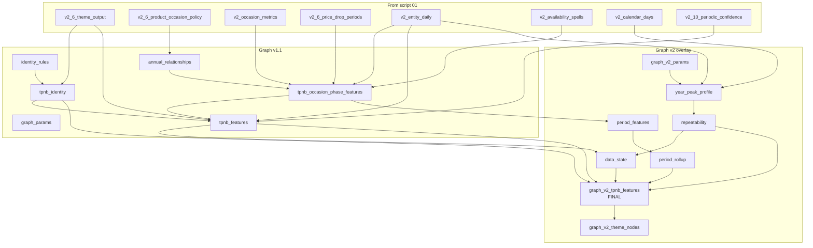

# Script 02: graph features

File: [`02_seasonality_graph_features_v2_1_period_vectors_full_build.sql`](../02_seasonality_graph_features_v2_1_period_vectors_full_build.sql)

**Prerequisite:** script 01 finished.

**What this script does in one sentence:** it takes the signed-off statistical results from script 01 and turns them into *graph-node features*: a behaviour class and evidence tier for every product, repeated time-of-year evidence, seasonal-versus-general sales split, phase timing flags, identity evidence and a data-state label.

**What it does not do:** it does not recompute any uplift statistics, and it keeps the source annual verdicts (`source_*` columns) and periodic ratings unchanged for audit.

The file holds **two scripts back to back**: *Graph features v1.1* (up to the `END OF BUILD` marker around line 1118) and the *Graph v2 overlay* (from about line 1119). Run both in file order. v2 reads v1's tables.

---

## Part 1: Graph features v1.1

### 0. `seasonality_graph_params`
| Parameter | Value | Meaning |
|---|---|---|
| `general_basket_share_min` | 0.20 | At least 20% of baskets outside seasonal periods to count as general |
| `general_active_week_positions_min` | 8 | and at least 8 distinct off-season week positions |
| `general_active_quarters_min` | 2 | and at least 2 off-season quarters |
| `general_baskets_min` | 104 | and at least 104 off-season baskets |
| `seasonal_led_basket_share_min` | 0.50 | Seasonal-led if at least half of baskets are seasonal |
| `phase_episode_basket_share_min` | 0.10 | A phase counts as material if it holds at least 10% of the episode's baskets |
| `phase_baskets_min` | 20 | and at least 20 baskets |
| `post_event_price_drop_sales_share_min` | 0.10 | Post-event clearance if at least 10% of POST sales were on price drop |
| `min_profile_baskets` | 104 | Minimum evidence for the broader time-of-year route |

### 1. `seasonality_graph_identity_rules` (editable dictionary)
Columns: `identity_occasion_key`, `identity_family`, `identity_season`, `match_scope` (`ANY_TEXT` or `HIERARCHY_TEXT`), `match_pattern`, `identity_strength` (`HARD` or `SOFT`).

Examples:
- Christmas: CHRISTMAS, XMAS, ADVENT, MINCE PIE(S), PANETTONE, STOLLEN, PIGS IN BLANKETS (WINTER)
- Halloween: HALLOWEEN, JAFFAWEEN, TRICK OR TREAT (AUTUMN)
- Bonfire: BONFIRE (HARD); FIREWORK(S), SPARKLER(S) in hierarchy (SOFT)
- Easter: EASTER, HOT CROSS, CREME EGG(S), MINI EGG(S), SIMNEL (SPRING)
- Valentine's (WINTER), Mother's Day (SPRING), Father's Day (SUMMER), Burns Night (HAGGIS), Diwali, Passover (PASSOVER, MATZO), Lunar New Year, Hanukkah, Pancake Day, Back to School, World Book Day.

Matching is done on text normalised to upper case with non-alphanumerics replaced by spaces and padded, so only whole words/phrases match.

### 2. `seasonality_graph_tpnb_identity` (one row per TPNB)
`explicit_seasonal_identity_flag`, `hard_seasonal_identity_flag`, `explicit_identity_count`, arrays and comma-lists of matched occasions, families and seasons, and `matched_identity_patterns`. **Identity is evidence about what a product *is*. By itself it never creates a seasonal flag;** observed timing or an accepted annual relationship is also needed.

### 3. `seasonality_graph_annual_relationships` (TPNB x parent occasion)
From script 01's final policy table, keeping two kinds of row:
- `ACCEPTED` (`accepted_final_annual`): the production relationship; status `CONFIDENT`.
- `HELD_REVIEW`: held rows (policy reason starts `HOLD_`) that still show a seasonal verdict. Kept so their observed signal can support a seasonal-pattern flag, **but they never receive a production occasion weight**. Attribution status: `CONFLICTING_PRODUCT_IDENTITY`, `SEASONAL_PERIOD_WITHOUT_APPROVED_NAMED_OCCASION` or `REVIEW_REQUIRED`.

### 4. `seasonality_graph_tpnb_occasion_phase_features` (TPNB x occasion x year x phase)
Phases: `BUILDUP`, `PRE_EVENT`, `EVENT`, `POST_EVENT`. For each, pulled from `seasonality_v2_occasion_metrics`: actual and expected baskets, share index, z-score, sales, plus day-level work: on-sale days, price-drop days and sales.

| Field | Rule |
|---|---|
| `measured_uplift_flag` | eligible, baseline ok, expected >= 10, share index >= 1.5 and z >= 3 |
| `material_phase_demand_flag` | phase has >= 20 baskets and >= 10% of the episode's baskets |
| **`period_seasonal_flag`** | `measured_uplift_flag` OR `material_phase_demand_flag`. The phase carries seasonal demand even when a baseline uplift cannot be measured |
| `phase_evidence_status` | `LOW_EXPECTED_VOLUME`, `INSUFFICIENT_BASELINE`, `SIGNIFICANT_UPLIFT`, `SIGNIFICANT_DECLINE`, `NOT_SIGNIFICANT` |
| `incremental_baskets/sales` | actual - expected (sales at baseline sales per basket) |
| `period_demand_weight`, `period_value_weight` | For ACCEPTED rows only: positive incremental baskets (sales) / the product's total accepted positive incremental baskets (sales) |
| `candidate_period_demand_weight`, `candidate_period_value_weight` | Same over all rows including HELD |
| `post_event_clearance_flag` | POST phase with at least 10% of sales on price drop |
| `period_id` | `<parent_occasion_key>__<year>__<phase>` |

### 5. `seasonality_graph_tpnb_features` (v1 node table, one row per TPNB)
Built from the theme output plus phase summaries:
- **Timing flags** (any seasonal phase): `season_before_flag` (BUILDUP or PRE_EVENT), `buildup_flag`, `pre_event_flag`, `season_event_flag`, `season_after_flag`, `post_event_clearance_flag`, and `seasonal_timing_profile` (`BEFORE_EVENT_AND_AFTER`, `BEFORE_AND_EVENT`, `EVENT_AND_AFTER`, `BEFORE_AND_AFTER`, `BEFORE_ONLY`, `EVENT_ONLY`, `AFTER_ONLY`, `SEASONAL_PERIOD_ONLY`, `NO_SEASONAL_PATTERN`).
- **Seasonal vs general:** days that fall in a seasonal phase of an accepted/held occasion are "seasonal days"; everything else is general sales. Gives `named_general_baskets/sales`, general active weeks/quarters/days.
- Flags `seasonal_pattern_flag`, `measured_seasonal_uplift_flag`, `general_sales_flag`, `seasonal_led_flag`, `seasonality_plus_general_flag`, `general_only_flag`.
- `occasion_attribution_status`: `CONFLICTING_PRODUCT_IDENTITY`, `AMBIGUOUS_OR_HELD_NAMED_OCCASION`, `CONFIDENT_ACCEPTED_OCCASION`, `SEASONAL_PERIOD_ONLY`, `NO_ACCEPTED_OCCASION`.
- `graph_feature_assignment_status` (explainability), periodic summary columns from `seasonality_v2_10_periodic_confidence`.

v1 classification is superseded by v2 below, but v2 reuses most of its columns.

---

## Part 2: Graph v2 overlay

### Why an overlay
The signed-off annual and periodic evidence is not recalculated. v2 tightens the *interpretation*: a time-of-year pattern with no named occasion only counts when it **repeats in the same broad season across at least two complete years**.

### 0. `seasonality_graph_v2_params`

| Parameter | Value | Meaning |
|---|---|---|
| `usable_year_baskets_min` | 104 | A year is usable with at least this many baskets |
| `usable_year_active_weeks_min` | 8 | and at least 8 active weeks |
| `repeated_pattern_min_usable_years` | 2 | Usable complete years needed |
| `repeated_pattern_min_same_peak_years` | 2 | Years with the same peak season |
| `repeated_pattern_peak_share_min` | 0.45 | Median peak-season basket share needed |
| `repeated_pattern_seasonal_led_share_min` | 0.50 | for "seasonal-led" |
| `general_basket_share_min` | 0.20 | General-sales materiality (as v1) |
| `general_active_week_positions_min` | 8 | |
| `general_active_quarters_min` | 2 | |
| `general_baskets_min` | 104 | |
| `cold_start_history_days` | 365 | Under a year of history = cold start |
| `short_sale_span_days` | 365 | Observed sale span shorter than a year |
| `inactive_days_for_short_lived` | 90 | |
| `low_volume_total_baskets_max` | 104 | Under this = low-volume long tail |
| `identity_peak_share_candidate_min` | 0.45 | Peak share needed to support an identity-only candidate |

### 1. `seasonality_graph_v2_tpnb_year_peak_profile` (TPNB x complete year)
Using only **complete** calendar years and week of year = `min(52, ceil(day-of-year/7))`, each week is assigned a broad season:

| Season | Weeks |
|---|---|
| WINTER | 49-52 and 1-8 |
| SPRING | 9-21 |
| SUMMER | 22-34 |
| AUTUMN | 35-48 |

The year's `peak_season` is the season with most baskets (`peak_season_basket_share`, `peak_season_sales_share`). `usable_complete_year_flag` needs the basket and active-week minimums.

### 2. `seasonality_graph_v2_tpnb_repeatability` (one row per TPNB)
- Over usable years, counts how often each season was the peak; the `strongest_observed_peak_season` is the most frequent (ties by median share).
- `repeated_peak_season` is set only if it was the peak in at least 2 years.
- **`repeated_time_of_year_pattern_flag` = 1** when usable years >= 2, same-peak years >= 2, and median peak-season basket share >= 0.45.
- **`repeated_time_of_year_seasonal_led_flag`** is the same with share >= 0.50.
- Also the off-peak totals (baskets, sales, active week positions, quarters, days) used for the general-sales test.

### 3. `seasonality_graph_v2_tpnb_period_features`
A renamed, clearer view of the phase table. Period vocabulary is **occasion x year x phase**, deliberately *not* P01-P12 (that happens in script 03).

### 3B. `seasonality_graph_v2_tpnb_period_rollup`
One row per TPNB, with **aligned arrays** (position-matched, keyed by `seasonality_period_id_array`) for every occasion-year-phase period: occasion key, year, phase, sold flag, actual baskets/sales and weights, incremental baskets/sales and weights, material-sales flag, measured-uplift flag, share index, z-score, and a struct array. Normalisation is within the same TPNB: actual weights use accepted material periods; incremental weights use only positive accepted incremental demand; candidate weights stay separate and never become accepted production weights.

### 4. `seasonality_graph_v2_tpnb_data_state` -> `graph_data_state`
First match wins:

| Order | Condition | State |
|---|---|---|
| 1 | Source says Review required, or the product has held candidate occasions | `ATTRIBUTION_CONFLICT_OR_REVIEW` |
| 2 | Source availability is "One-off limited edition" | `ONE_OFF_RANGE_NO_REPEAT_TEST` |
| 3 | Observable history (data end minus first sale) under 365 days | `COLD_START_NEW_PRODUCT_UNDER_12_MONTHS` |
| 4 | Observed sale span under 365 days **and** no sale for 90+ days | `SHORT_LIVED_OR_DELISTED_RANGE` |
| 5 | Total baskets under 104 | `LOW_VOLUME_LONG_TAIL` |
| 6 | Source availability is "Intermittent" | `INTERMITTENT_OR_RANGE_LIMITED` |
| 7 | Any accepted occasion, **or** repeated time-of-year pattern, **or** 2+ usable complete years, **or** (source Regular/Occasion-suppressed with 365+ days of history) | `MATURE_MULTI_YEAR_HISTORY` |
| 8 | Explicit seasonal identity | `SEASONAL_IDENTITY_WITHOUT_CONFIRMED_BEHAVIOUR` |
| 9 | At least 8 active week positions and 2 active quarters | `SUFFICIENT_VOLUME_NO_STABLE_ANNUAL_PATTERN` |
| 10 | otherwise | `OTHER_LIMITED_EVIDENCE` |

Note the state is a *description of data quality*; it does not itself change the class or tier.

### 5. `seasonality_graph_v2_tpnb_features` (FINAL, one row per TPNB)

Base is `seasonality_graph_tpnb_features` (v1) joined to `seasonality_v2_6_theme_output`, identity, repeatability, data state and period rollup. **Rows for TPNBs missing from the theme output are dropped** (inner join).

Derived signals

| Signal | Rule |
|---|---|
| `accepted_named_seasonal_flag` | at least one `ACCEPTED` occasion |
| `reviewed_or_held_seasonal_signal_flag` | source says Review required, or has held candidate occasions |
| `identity_supported_candidate_flag` | explicit seasonal identity **and** (source availability is Recurring seasonal / One-off limited edition, **or** peak-season share >= 0.45, **or** a time-of-year "peak" pattern with best 8-week share >= 45%) |
| `repeated_time_of_year_pattern_flag` | from repeatability |
| `seasonal_pattern_flag` | any of the above four |
| `measured_seasonal_uplift_flag` | measured phase uplift, or accepted with source Uplift seasonal |

Seasonal share (`seasonal_basket_share_pct`, sales share) depends on the evidence route, and `seasonal_share_measure_type` records which:

| Route | Seasonal share is... | `seasonal_share_measure_type` |
|---|---|---|
| Accepted or held named occasion | share of baskets/sales on days inside seasonal phases (else best 8-week share) | `NAMED_OCCASION_PHASES` |
| Repeated time-of-year only | repeated peak-season median share x 100 | `REPEATED_BROAD_SEASON_R45_2Y` |
| Identity-supported candidate | strongest-peak median share, else best 8-week share | `IDENTITY_WITH_OBSERVED_PATTERN_PROXY` |
| none | 0 | `NO_SEASONAL_SHARE` |

General share = 100 - seasonal share, and `general_sales_flag` needs the materiality thresholds above on the *general* (off-seasonal) baskets/weeks/quarters.

Final flags
- `seasonal_led_flag`: Specifically seasonal with accepted occasion; OR seasonal pattern with seasonal share >= 50%; OR seasonal pattern with no material general sales.
- `seasonality_plus_general_flag`: seasonal pattern and general sales.
- `general_only_flag`: no seasonal pattern and general sales.

### Classification (the heart of the script)

`graph_behavior_class` / `graph_evidence_tier` / `graph_behavior_reason`, first match wins:

| # | Condition | Class | Tier | Reason |
|---|---|---|---|---|
| 1 | Accepted named seasonal + general sales | `SEASONALITY_PLUS_GENERAL` | CONFIRMED | `ACCEPTED_NAMED_ANNUAL_SEASONALITY` |
| 2 | Accepted named seasonal | `SEASONAL_LED` | CONFIRMED | same |
| 3 | Reviewed/held seasonal signal | `SEASONAL_PATTERN_CANDIDATE` | PROVISIONAL | `HELD_OR_REVIEWED_SEASONAL_SIGNAL` |
| 4 | Repeated time-of-year + general sales | `SEASONALITY_PLUS_GENERAL` | SUPPORTED | `REPEATED_TIME_OF_YEAR_PATTERN_R45_2Y` |
| 5 | Repeated time-of-year | `SEASONAL_LED` | SUPPORTED | same |
| 6 | Identity-supported candidate | `SEASONAL_PATTERN_CANDIDATE` | PROVISIONAL | `EXPLICIT_IDENTITY_WITH_OBSERVED_OR_RANGE_PATTERN` |
| 7 | Source Regular/Occasion-suppressed + general sales | `GENERAL_ONLY` | CONFIRMED | `CONFIRMED_DISTRIBUTED_GENERAL_SALES` |
| 8 | Source Insufficient evidence + general sales | `GENERAL_PATTERN_CANDIDATE` | PROVISIONAL | `PROVISIONAL_DISTRIBUTED_GENERAL_SALES` |
| 9 | anything else | `LOW_INFORMATION_NODE` | LOW_INFORMATION | `NO_RELIABLE_BEHAVIOUR_YET` |

(Row 7's tier is CONFIRMED only when `seasonal_pattern_flag = 0`.)

Training labels: `graph_training_label_flag = 1` for rows 1-2 (accepted named seasonality) and row 7 (confirmed general-only); `graph_training_label_weight` is that flag as a double; candidate classes are never labels. `graph_node_inclusion_flag` is always 1 (every TPNB remains a node).

`theme_behavior_flag` = class is one of `SEASONAL_LED`, `SEASONALITY_PLUS_GENERAL`, `GENERAL_ONLY`. `confirmed_commercial_theme_flag` = that and tier CONFIRMED.

Other fields

- `identity_timing_alignment`: how the observed peak season relates to the identity season: `ALIGNED_WITHIN_IDENTITY_SEASON`, `ALIGNED_BEFORE_IDENTITY_SEASON`, `ALIGNED_AFTER_IDENTITY_SEASON`, `ALIGNED_TO_UNRELATED_SEASON`, `SEASONAL_IDENTITY_WITHOUT_RELIABLE_PEAK_SEASON`, `NO_SEASONAL_ALIGNMENT`, `NO_EXPLICIT_SEASONAL_IDENTITY`, `CONFLICTING_NAMED_OCCASION`.
- `seasonal_timing_profile` and timing flags are zeroed unless `seasonal_pattern_flag = 1`.
- `multi_seasonal_peak_flag` = 2+ accepted/held occasions, or 2+ years with the same peak.
- `theme_node_key = <subcategory_code>|<graph_behavior_class>`; `theme_node_display_name = "<subclass name> - <class label>"`.
- `as_of_date` = date the script ran.

### 6. `seasonality_graph_v2_theme_nodes` (subclass x behaviour)
Aggregates per theme node: product counts by tier, training-label count, total baskets and sales, basket-weighted seasonal and general share, average repeated-peak share, average max share index and z, percentage of products with before/event/after phases, measured uplift, seasonal-led, general and periodic-high, the most common primary occasion (`dominant_primary_occasion`) and peak season (`dominant_peak_season`), plus `theme_behavior_node_flag` and `confirmed_commercial_theme_node_flag` (at least one CONFIRMED product). **This table is replaced by script 03's version and is not read downstream.**

---

## Reading the result
- Business theme membership: use `theme_node_key` when `theme_behavior_flag = 1`; trust it for reporting when the tier is `CONFIRMED`.
- Modelling: every TPNB is a node; use `graph_training_label_*` only for labels.
- Seasonal and general behaviour are **not mutually exclusive**; a product can be both (`SEASONALITY_PLUS_GENERAL`).

**Next:** [03_final_node_build.md](03_final_node_build.md).
