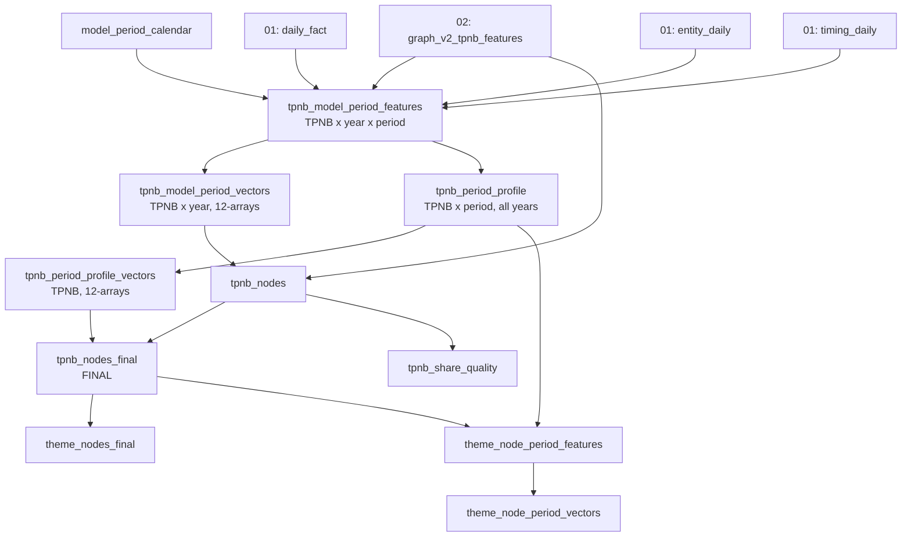

# Script 03: final node build (model periods, P01-P12 vectors, final nodes)

File: [`03_seasonality_graph_final_node_build.sql`](../03_seasonality_graph_final_node_build.sql)

**Prerequisites:** scripts 01 **and** 02 finished.

**What this script does in one sentence:** it maps every date to one of 12 model periods (P01-P12), builds each product's monthly demand and seasonality vectors, repairs hierarchy gaps and out-of-range shares, and writes the final node tables and theme-node tables.

**Why it needs script 01 as well as 02:** it reads script 02's `seasonality_graph_v2_tpnb_features` for classification, and script 01's `seasonality_v2_daily_fact`, `seasonality_v2_calendar_days`, `seasonality_v2_entity_daily` and `seasonality_v2_6_timing_daily` for the period maths.

The file is **three scripts in one**, run in order (the comments name them `00_`, `10_/11_` and the final one):

| Section | Lines | Builds |
|---|---|---|
| A. Parameters and calendar | 1-104 | `final_params`, `model_period_calendar`, `model_period_summary` |
| B. Period features, year vectors, first node tables | 105-908 | `tpnb_model_period_features`, `tpnb_model_period_vectors`, `tpnb_nodes`, first versions of the theme-node tables |
| C. Final nodes and fixes | 909-1453 | `tpnb_period_profile`, `tpnb_period_profile_vectors`, `tpnb_share_quality`, **`tpnb_nodes_final`**, final theme-node tables (replacing the section B versions) |

---

## A. Parameters and the model-period calendar

### `seasonality_graph_final_params` (1 row)

| Field | Value | Meaning |
|---|---|---|
| `analysis_start_date` | 2023-01-01 | Window start (hard-coded) |
| `analysis_end_date_exclusive` | 2027-01-01 | Window end (hard-coded) |
| `model_period_scheme` | `CALENDAR_MONTH_12_PROVISIONAL` | See below |
| `provisional_period_calendar_flag` | 1 | The scheme is a stand-in |
| `min_tpnb_pair_baskets_per_period` / `_all_years` | 2 / 10 | Graph sparsification for product pairs (for a later edge build) |
| `min_theme_pair_baskets_per_period` / `_all_years` | 5 / 20 | Same, for theme pairs |
| `percentage_tolerance`, `weight_tolerance` | 1e-6 | Numeric tolerance for bounds checks |
| `commercial_theme_behavior_array` | SEASONAL_LED, SEASONALITY_PLUS_GENERAL, GENERAL_ONLY | Classes that can be business-facing themes |
| `build_date` | today | |

The pair-support thresholds are graph sparsification settings, not seasonality filters, and are not used by anything in this repo's scripts yet.

### `seasonality_graph_model_period_calendar` (one row per date)
Fields: `cal_date`, `period_year`, `period_number`, `period_id` (e.g. `2024-P03`), `period_start_date`, `period_end_date`, `calendar_days_in_period`, `period_is_complete_flag`, `date_is_observed_flag`, `period_scheme`.

> **P01-P12 are calendar months (P01 = January, ..., P12 = December)** because the official Tesco commercial-period calendar has not been supplied. To switch, replace *only this table* with the official date-to-period mapping. Downstream scripts do not need to change (but the vectors then no longer mean "month").

`seasonality_graph_model_period_summary` summarises periods for validation (not read downstream).

---

## B. Period features and vectors

### `seasonality_graph_tpnb_model_period_features` (TPNB x year x period)

Scope: every TPNB with `graph_node_inclusion_flag = 1` (all of them). Key outputs per period:

| Field | Meaning |
|---|---|
| `actual_baskets`, `actual_sales`, `actual_units`, `active_sale_days` | Raw activity in that period |
| `market_baskets`, `market_item_slots`, `market_sales` | Market totals for the period |
| `actual_*_weight_within_tpnb_year` | This period's share of the TPNB's own year (sums to 1 across the 12 periods) |
| `active_day_expected_baskets/sales` | What an even spread over the product's active sale days would give |
| `active_day_basket_rate_index`, `active_day_sales_rate_index` | actual / that expectation. 1.0 = an average active-day rate |
| `positive_excess_baskets/sales` | max(actual - active-day expectation, 0), and `positive_excess_*_weight_within_tpnb_year` |
| `period_basket_penetration`, `year_basket_penetration`, **`period_basket_penetration_index`** | Share of market baskets containing the product in the period / in the year, and their ratio |
| `period_baskets_zscore`, `period_sales_zscore` | z-score of the period against the product's 12 periods in that year |
| `named_positive_incremental_baskets/sales`, `named_seasonal_days`, `named_seasonality_*_weight_within_tpnb_year` | **Exact accepted named-season** incremental demand taken from script 01's `timing_daily`, mapped to the period of each date. Overlapping accepted occasions on one date use `MAX` per TPNB x date so the same daily demand is never counted twice |
| **`period_seasonality_sales_weight` / `_basket_weight`** | If the product has named incremental demand in the year: its period share. Else if `repeated_time_of_year_pattern_flag = 1`: the period share of positive excess. Else 0 |
| `period_seasonality_weight_source` | `ACCEPTED_NAMED_OCCASION_INCREMENTAL`, `REPEATED_TIME_OF_YEAR_EXCESS`, `NO_SEASONAL_PERIOD_WEIGHT` |
| `period_seasonal_flag` | Product has a seasonal pattern **and** (named incremental sales in the period, or a repeated pattern with positive excess) |
| `sold_flag` | Any basket in the period |

### `seasonality_graph_tpnb_model_period_vectors` (TPNB x year)
Zero-filled 12-element arrays (`SEQUENCE(1,12)`, missing periods become 0): `period_sold_flag_array`, `period_actual_baskets_array`, `period_actual_sales_array`, `..._basket_weight_array`, `..._sales_weight_array`, `period_basket_rate_index_array`, `period_sales_rate_index_array`, `period_basket_penetration_index_array`, `period_positive_excess_baskets/sales_array`, `period_seasonality_basket/sales_weight_array`, `period_seasonal_flag_array`, `period_sales_zscore_array`, `period_baskets_zscore_array`, and `model_period_feature_array` (an array of 12 structs holding all of the above for one period). Also `year_has_complete_period_flag`.

Normalisation is **within the same TPNB and year**.

### `seasonality_graph_tpnb_nodes` (first node table)
Script 02's final features plus a corrected subclass and a per-year array `model_period_year_feature_array`. Keeps raw shares as `seasonal_basket_share_pct_raw`, `general_basket_share_pct_raw`, `seasonal_sales_share_pct_raw`, `general_sales_share_pct_raw`, with `share_out_of_bounds_flag`. Superseded by `tpnb_nodes_final`.

### First versions of theme-node tables
`seasonality_graph_theme_nodes_final`, `seasonality_graph_theme_node_period_features` and `seasonality_graph_theme_node_period_vectors` are created here **per theme x year** (and keyed on the section B subclass-only key). **They are dropped and recreated in section C with a different grain** (see below), so only the section C versions survive a full run.

---

## C. Final nodes and data-quality fixes

### `seasonality_graph_tpnb_period_profile` (TPNB x period, all years)
Collapses the years: for each period number, sums baskets, sales, units, active days, market totals, positive excess and named incremental demand across all years, and:

- `observed_year_count`, `sold_period_year_count`: how many years the period was in the window and how many years the product sold in it,
- `actual_basket_weight_within_tpnb`, `actual_sales_weight_within_tpnb`, `actual_units_weight_within_tpnb`: share of the product's **all-years** total,
- `positive_excess_*` and `named_incremental_*` weights within the TPNB,
- `period_seasonality_sales_weight` / `_basket_weight`: named incremental share if the product has any, else repeated-pattern excess share, else 0 (and `period_seasonality_weight_source`),
- `period_seasonal_flag`,
- mean within-year weights, mean rate indices, mean penetration index and mean z-scores across years.

### `seasonality_graph_tpnb_period_profile_vectors` (one row per TPNB)
Zero-filled 12-element arrays of the above. These are the `*_array_12` columns in the final node table: **all-years, within-TPNB normalised**. Period 1 is index 1 of every array.

### `seasonality_graph_tpnb_share_quality`
Audit list of products with any raw seasonal/general share outside 0-100 (`any_share_out_of_bounds_flag`, and `material_share_out_of_bounds_flag` when outside the 1e-6 tolerance). Not read downstream.

### `seasonality_graph_tpnb_nodes_final` (**FINAL, one row per TPNB**)

Takes `tpnb_nodes` (`o.*`) and adds:

1. **Hierarchy fallback** so the theme key is never blank:

   | Order | Source used | `theme_hierarchy_level` | `effective_subcategory_code` looks like |
   |---|---|---|---|
   | 1 | Subclass present | `SUBCLASS` | the subclass code |
   | 2 | else class name | `CLASS_FALLBACK` | `CLASS_FALLBACK:<CLASS_NAME_UPPER_UNDERSCORED>` |
   | 3 | else section name | `SECTION_FALLBACK` | `SECTION_FALLBACK:<...>` |
   | 4 | else department name | `DEPARTMENT_FALLBACK` | `DEPARTMENT_FALLBACK:<...>` |
   | 5 | else | `UNKNOWN` | `UNKNOWN_SUBCLASS` |

   with matching `effective_subcategory_name` (`[Class fallback] <name>` etc.) and `missing_subclass_flag`.
2. **Theme key and name:** `final_theme_node_key = <effective_subcategory_code>|<graph_behavior_class>`; `final_theme_node_display_name = "<name> - <label>"`.
3. **Theme eligibility:** `commercial_theme_eligible_flag` = level is `SUBCLASS` and class is one of the three commercial classes; `confirmed_commercial_theme_eligible_flag` = level `SUBCLASS` and `confirmed_commercial_theme_flag = 1`. **Products grouped by a fallback level are never commercially eligible.**
4. **Share clamping:** `final_seasonal_basket_share_pct`, `final_general_basket_share_pct`, `final_seasonal_sales_share_pct`, `final_general_sales_share_pct` are the raw shares limited to 0-100. `share_clamped_flag` says if any raw value was outside 0-100.
5. **P01-P12 vectors** from the profile vectors (`period_*_array_12`, `model_period_feature_array_12`), with `final_period_vector_order = 'P01_TO_P12_ALL_OBSERVED_YEARS'` and `final_period_normalisation_scope = 'WITHIN_TPNB_FULL_ANALYSIS_WINDOW'`.

All other columns of script 02's final features pass through unchanged.

> **Use the `final_*` and `effective_*` columns** for the graph and theme membership, not the original `theme_node_key` / `subcategory_*` / `*_share_pct_raw`.

### Final theme-node tables (these replace the section B versions)

| Table | Grain | Contents |
|---|---|---|
| `seasonality_graph_theme_nodes_final` | `final_theme_node_key` | `theme_hierarchy_level`, `missing_subclass_flag`, behaviour class, flags, product counts by evidence tier, `training_label_tpnb_count`, `confirmed_tpnb_share_pct`, `supported_tpnb_share_pct`, total baskets/sales, basket-weighted seasonal and general shares, average repeated-peak share, average max index and z, percent of products with before / event / after phases, measured uplift, seasonal-led, general-sales and periodic-high |
| `seasonality_graph_theme_node_period_features` | theme x period (**all years**) | `sold_tpnb_count`, theme baskets and sales, positive excess, named incremental demand; `theme_period_basket_weight`, `theme_period_sales_weight`, `..._positive_excess_sales_weight`, `..._named_incremental_sales_weight`; `sales_weighted_product_seasonality_weight` and `sold_product_seasonal_share` |
| `seasonality_graph_theme_node_period_vectors` | theme | 12-element arrays: `period_sold_tpnb_count_array_12`, `period_theme_baskets_array_12`, `..._sales_array_12`, `..._basket_weight_array_12`, `..._sales_weight_array_12`, `..._positive_excess_sales_weight_array_12`, `..._named_incremental_sales_weight_array_12`, `..._seasonality_weight_array_12`, `..._seasonal_product_share_array_12` |

**Grain warning:** in section B the theme period tables were per theme x **year** (array columns without the `_12` suffix, e.g. `period_theme_baskets_array`). In section C they are per theme (all years) with `_12` suffixed arrays. A full run leaves the section C version. If a run is interrupted after section B, the tables have the old grain.

---

## Quick reference: which table do I want?

| Question | Table |
|---|---|
| One row per product, ready for modelling | `seasonality_graph_tpnb_nodes_final` (or its view, script 04) |
| A product's monthly profile, year by year | `seasonality_graph_tpnb_model_period_vectors` |
| A product's monthly profile, all years | `seasonality_graph_tpnb_period_profile_vectors` |
| What themes exist and how big are they | `seasonality_graph_theme_nodes_final` |
| A theme's monthly profile | `seasonality_graph_theme_node_period_vectors` |
| Which products have bad shares | `seasonality_graph_tpnb_share_quality` |

**Next:** [04_model_ready_output.md](04_model_ready_output.md).
